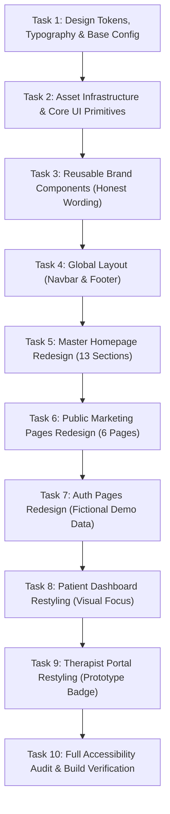

# VOCALRISE — MASTER VISUAL REDESIGN IMPLEMENTATION PLAN (REVISED)

**Plan Version:** 1.1.0  
**Date:** November 5, 2026  
**Status:** Revised Implementation Plan (Incorporating User Adjustments — Awaiting Final Approval)  
**Target Specification:** [`docs/superpowers/specs/2026-11-05-vocalrise-visual-redesign.md`](file:///home/harsh/Downloads/Vocal%20Rise/docs/superpowers/specs/2026-11-05-vocalrise-visual-redesign.md)  
**Codebase:** Next.js 14.2.35 App Router, React 18.3.1, TypeScript 5.7.3, Tailwind CSS 3.4.17  

---

## 1. Plan Overview & Refined Boundary Rules

This revised implementation plan details the transformation of the VocalRise web application into the **Atlantic Calm** visual identity. It explicitly incorporates all user adjustments regarding clinical honesty, fictional demo data, visual focus, package compatibility, and preservation of existing prototype functionality.

### 1.1 Core Boundaries & Adjustments

1. **Honest Clinical & Prototype Wording (Zero Unsubstantiated Claims):**
   - The platform will **never** claim unverified clinical partnerships, formal institutional endorsements, or clinical validation studies.
   - All references to speech-language pathology are framed honestly as:
     - *"Designed with clinician-informed principles — prototype practice platform for speech techniques."*
     - *"Evidence-informed practice concepts."*
     - Clear prototype indicators: `[Prototype Preview: Demo Account]`.
   - Never invent research numbers, recovery percentages, or fake practitioner registries.

2. **Strictly Fictional Demo Credentials:**
   - Any demo accounts will use obviously fictional addresses:
     - Patient Demo: `demo.speaker@example.com`
     - Clinician Demo: `demo.therapist@example.com`
   - No real user names, private email addresses, or actual clinician credentials will be used.

3. **Strict Focus on Visual Redesign (No Major Functional Overhauls):**
   - This project transforms the **visual presentation, brand identity, layout, colors, typography, spacing, borders, cards, and theme consistency**.
   - It will **not** rewrite or introduce major functional changes to:
     - The onboarding engine or registration redirection flows.
     - The audio capture engine (retaining the existing functional `AudioRecorderModal` simulation).
     - The pathway switching state logic in `/dashboard` (preserving `currentPathway` state).
     - Therapist permission logic or backend database connections.
   - Any future functional or architectural expansions remain deferred to separate phases.

4. **100% Preservation of Existing Routes, Mock Data & Interfaces:**
   - All 11 existing routes are preserved: `/`, `/how-it-works`, `/stammering`, `/articulation-and-lisping`, `/about`, `/pricing`, `/resources`, `/login`, `/signup`, `/dashboard`, `/therapist`.
   - All TypeScript types in `src/types/` (`user.ts`, `practice.ts`, `therapist.ts`) and mock datasets in `src/lib/mock-data.ts` remain intact.
   - Component props and state contracts will be maintained so existing interactive behaviors remain fully operational.

5. **Package & Configuration Compatibility:**
   - `motion` (Motion for React) has verified peer-dependency support for `react: ^18.0.0` (matching installed React 18.3.1).
   - Fonts are loaded via Next.js built-in `next/font/google` (zero additional npm packages).
   - Tailwind CSS 3.4.17 is configured with Atlantic Calm semantic tokens without requiring major version upgrades.

6. **Accessibility, Privacy & Clinical Safeguards:**
   - WCAG 2.2 AA compliance: 4.5:1 text contrast, 3:1 UI components.
   - Sensory safety: No high-pressure countdown timers, no alarm buzzers, full `prefers-reduced-motion` support.
   - Privacy: Zero audio blobs or clinical notes stored in `localStorage` or `sessionStorage`. Only UI theme (`vocalrise_theme`) is stored in `localStorage`.
   - Neurodiversity-affirming ethos: Stammering is never called a "pronunciation defect"; no cure claims; success includes confidence, ease, and participation.

---

## 2. Task-by-Task Implementation Roadmap



---

### Task 1: Design Tokens, Typography & Base Configuration

#### 1.1 Objective
Configure Tailwind CSS, Google Fonts (`Manrope` and `DM Sans`), and global CSS variables to implement the Atlantic Calm design system in both light and dark modes, ensuring 100% compatibility with existing React 18 and Next.js 14 versions.

#### 1.2 Exact Files to Modify
- `package.json` — Add `motion` (`^11.11.17` or compatible `motion` release with React 18 peer support).
- `tailwind.config.ts` — Configure Atlantic Calm color palette, font families, radius scale, and custom shadows.
- `src/app/globals.css` — Update `:root` and `.dark` CSS variables, focus rings, and base background/text colors.
- `src/app/layout.tsx` — Integrate `next/font/google` for `Manrope` (headings) and `DM_Sans` (body), apply font CSS variables to `<html>`, and preserve the anti-FOUC script.

#### 1.3 Detailed Configuration
1. **`tailwind.config.ts` Tokens:**
   ```ts
   colors: {
     ocean: {
       DEFAULT: "#315F78",
       hover: "#264A5E",
       light: "#417A99",
       dark: "#1E3B4B",
     },
     midnight: {
       DEFAULT: "#243746",
       surface: "#1A2833",
       deep: "#111D25",
     },
     mist: {
       DEFAULT: "#E7EFF2",
       subtle: "#F0F5F7",
       dark: "#15232C",
     },
     porcelain: {
       DEFAULT: "#F7F9F8",
     },
     softblue: {
       DEFAULT: "#A9C4D1",
       hover: "#92B3C3",
     },
     terracotta: {
       DEFAULT: "#C9826D",
       glow: "#D69A84",
     },
     stone: {
       DEFAULT: "#4B555A",
       muted: "#6B7C85",
     },
     // Preserving existing semantic brand tokens for backward compatibility
     brand: {
       50: "#F0F5F7",
       100: "#E7EFF2",
       200: "#A9C4D1",
       500: "#417A99",
       600: "#315F78", // Ocean Blue primary
       700: "#264A5E",
       800: "#243746",
       900: "#1A2833",
       950: "#111D25",
     },
     cerulean: {
       50: "#F0F5F7",
       600: "#315F78",
       700: "#243746",
     }
   },
   fontFamily: {
     heading: ["var(--font-manrope)", "sans-serif"],
     sans: ["var(--font-dm-sans)", "sans-serif"],
   },
   borderRadius: {
     "card": "16px",
     "panel": "24px",
     "container": "32px",
   }
   ```
2. **`globals.css` Variables:**
   - Light: `--background: #F7F9F8`, `--foreground: #243746`, `--border: #D5E1E6`, `--accent: #315F78`.
   - Dark: `--background: #111D25`, `--foreground: #F2F6F7`, `--border: #304653`, `--accent: #83B5CC`.
3. **`layout.tsx` Fonts:**
   ```tsx
   import { Manrope, DM_Sans } from "next/font/google";
   const manrope = Manrope({ subsets: ["latin"], variable: "--font-manrope", display: "swap" });
   const dmSans = DM_Sans({ subsets: ["latin"], variable: "--font-dm-sans", display: "swap" });
   ```

#### 1.4 Verification Steps
1. Run `npm install motion` and verify `package.json`.
2. Run `npm run build` and ensure CSS compiles with exit code 0.
3. Open `http://localhost:3000` and inspect DOM: verify `--font-manrope` and `--font-dm-sans` classes are present on `<html>`.

#### 1.5 Rollback Consideration
Revert `tailwind.config.ts`, `globals.css`, and `layout.tsx` to prior versions. Run `npm uninstall motion`.

---

### Task 2: Asset Infrastructure & Core UI Primitives Restyling

#### 2.1 Objective
Establish the `public/images/` directory structure, populate candid photography and responsive SVG graphic fallbacks, and restyle core UI primitives in `src/components/ui/` with Atlantic Calm design tokens.

#### 2.2 Exact Files to Modify / Create
- `public/images/hero/candid-speaker.webp` (Candid communication lifestyle visual asset)
- `public/images/pathways/stammering-support.webp` (Warm conversational interaction visual asset)
- `public/images/pathways/articulation-support.webp` (Focused phonetic speech practice visual asset)
- `public/images/editorial/therapist-consultation.webp` (Attentive SLT consultation visual asset)
- `public/images/placeholders/hero-gradient-mesh.svg` (Soft blue-to-white atmosphere gradient)
- `src/components/ui/button.tsx` — Add Atlantic Calm variants (`primary` Ocean Blue, `secondary` Mist, `outline` Soft Blue border, `terracotta`).
- `src/components/ui/card.tsx` — Update border and shadow tokens to match Atlantic Calm container hierarchy.
- `src/components/ui/badge.tsx` — Add Atlantic Calm variants (`ocean`, `softblue`, `terracotta`, `mist`, `success`, `warning`).
- `src/components/ui/progress.tsx` — Restyle progress bar fill with Ocean Blue.
- `src/components/ui/modal.tsx` — Update with `rounded-3xl` container, subtle oceanic border, backdrop blur, and accessible focus trap.

#### 2.3 Detailed Changes
- Buttons: `bg-ocean text-white hover:bg-ocean-hover shadow-sm` for primary; `border border-[#A9C4D1] text-[#243746] dark:border-[#304653] dark:text-[#F2F6F7]` for outline.
- Cards: `rounded-2xl border border-[#D5E1E6] bg-white text-[#243746] shadow-card dark:border-[#304653] dark:bg-[#192A35] dark:text-[#F2F6F7]`.
- Modals: `rounded-[28px] border border-[#D5E1E6] bg-white shadow-elevated dark:border-[#304653] dark:bg-[#192A35]`.

#### 2.4 Verification Steps
1. Verify `public/images/` directory exists and assets are accessible via browser at `http://localhost:3000/images/...`.
2. Run `npm run build` to verify all updated UI primitives compile without TypeScript errors.

#### 2.5 Rollback Consideration
Delete newly added assets in `public/images/` and revert `src/components/ui/*` files.

---

### Task 3: Create New Reusable Brand Components (Honest Wording)

#### 3.1 Objective
Create the 6 new reusable editorial and trust components required by the Atlantic Calm design system, ensuring all copy adheres to honest prototype standards.

#### 3.2 Exact Files to Create
- `src/components/ui/announcement-bar.tsx` — Top notice bar with honest prototype wording.
- `src/components/ui/pathway-card.tsx` — Reusable dual-pathway comparison card with distinct Stammering vs Articulation visual cues.
- `src/components/ui/product-preview.tsx` — Interactive showcase bezel displaying actual application tabs.
- `src/components/ui/trust-indicator.tsx` — Horizontal product principles badge row.
- `src/components/ui/faq-accordion.tsx` — Accessible, keyboard-navigable question & answer accordion with smooth expand/collapse.
- `src/components/ui/section-heading.tsx` — Standardized editorial heading with badge, Manrope title, and subtitle.

#### 3.3 Detailed Component Architecture & Honest Copy
- **`announcement-bar.tsx`:**  
  *Copy:* `"Designed with clinician-informed principles — prototype practice platform for speech techniques"` with discreet link: `"Explore Clinician Portal Demo →"`.
- **`pathway-card.tsx`:**  
  Supports `type: "stammering" | "articulation"`, rendering custom pillars, badges, and distinct callouts. Clearly states: *"Stammering is a neuro-motor fluency difference, not an articulation error."*
- **`product-preview.tsx`:**  
  3 interactive tabs (*"Daily Practice Studio"*, *"Confidence Journal"*, *"Therapist Review Deck"*), switching real rendered prototype components inside a sleek browser frame.
- **`trust-indicator.tsx`:**  
  4 honest product principles (Personal Goals First, Distinct Pathways, Optional Clinician Collaboration, Privacy-Conscious Voice Data).
- **`faq-accordion.tsx`:**  
  Answers 8 common questions with clinical honesty (confirming VocalRise does not promise a cure, does not replace licensed medical therapy, and does not diagnose conditions).

#### 3.4 Verification Steps
1. Run `npm run build` to ensure all 6 new components have 100% strict TypeScript types and zero lint errors.

#### 3.5 Rollback Consideration
Delete the 6 new files in `src/components/ui/`.

---

### Task 4: Global Layout Redesign (Navbar & Footer)

#### 4.1 Objective
Transform the global header and footer into the polished, high-trust editorial style of Atlantic Calm, using honest prototype language.

#### 4.2 Exact Files to Modify
- `src/components/layout/Navbar.tsx`
- `src/components/layout/Footer.tsx`

#### 4.3 Detailed Changes
- **`Navbar.tsx`:**
  - Embed `AnnouncementBar` above main header.
  - Redesign logo: Ocean Blue soundwave squircle + "Vocal" in Midnight Slate / White, "Rise" in Ocean Blue, subtitle "Speech & Communication SaaS".
  - Clean desktop navigation links with active state pill styling (`bg-mist/70 text-ocean dark:bg-mist-dark dark:text-softblue`).
  - Restyled `ThemeToggle` with smooth micro-animation.
  - Accessible mobile drawer with slide-in animation, 44px+ touch targets, and role quick-switchers.
- **`Footer.tsx`:**
  - Midnight Slate background (`bg-[#243746] dark:bg-[#111D25]`).
  - 5-column layout: Brand & Neurodiversity Ethos, Speech Pathways, Clinicians, Resources, Legal & Trust.
  - Trust indicators: "Clinician-Informed Framework" and "Respectful Support".
  - Working links to `/stammering`, `/articulation-and-lisping`, `/how-it-works`, `/pricing`, `/about`, `/resources`, `/therapist`, `/login`.

#### 4.4 Verification Steps
1. Test on mobile view (320px–430px): open and close navigation drawer, tap each navigation item.
2. Test on desktop view (1024px–1440px): verify sticky glass blur, theme switcher toggle, and footer links.
3. Verify zero hydration errors in browser developer console.

#### 4.5 Rollback Consideration
Revert `src/components/layout/Navbar.tsx` and `src/components/layout/Footer.tsx` to prior version.

---

### Task 5: Master Homepage Redesign (`src/app/page.tsx`)

#### 5.1 Objective
Redesign the homepage into the complete 13-section editorial health-tech showcase defined in Section 7 of the specification, strictly upholding clinical honesty and prototype disclosures.

#### 5.2 Exact Files to Modify
- `src/app/page.tsx`

#### 5.3 Detailed Structure of the 13 Sections
1. **Announcement Bar:** Honest clinician-informed prototype notice.
2. **Editorial Header & Navigation:** Glassmorphic sticky nav.
3. **Hero Section:**
   - Left: Manrope H1 *"Your voice. Your pace. Your journey."*, supporting narrative, Primary CTA *"Explore VocalRise"* (`/signup`), Secondary CTA *"See How It Works"* (`/how-it-works`), trust checkmarks (*"No diagnostic pressure • Private by default • Built around your goals"*).
   - Right: Candid lifestyle photograph framed in `rounded-[32px]` container with subtle blue-to-white gradient wash (`from-[#E7EFF2]/80 via-[#F7F9F8] to-transparent`) and floating micro-drill preview pill.
4. **Trust Indicators Row:** 4 principles (Personal Goals First, Two Distinct Pathways, Optional SLT Collaboration, Privacy-Conscious Practice).
5. **Pathway Selection Cards:** Two prominent container cards:
   - Stammering Support Card (Gentle onset, voluntary stuttering, avoidance reduction).
   - Articulation & Lisping Support Card (Alveolar contact, central airflow, minimal pairs, rhotic /r/).
   - Clinical distinction callout: *"Stammering is a neuro-motor fluency difference, not an articulation error."*
6. **How VocalRise Works (6-Step Visual Journey):** Steps 01 to 06 with numbered indicators and clear icons.
7. **Live Product Experience Showcase:** Browser-frame preview with 3 interactive tabs rendering real dashboard cards.
8. **Editorial Feature Breakdown:** Alternating split sections for Guided Practice, Personal Reflection, and Progress Beyond Numbers.
9. **Clinician Partnership Section:** Attentive SLT consultation imagery and asynchronous review explanation (noting that sharing is optional and requires explicit client permission).
10. **Privacy & Ethical Safety Panel:** Enclosed card highlighting private-by-default recordings, zero audio in `localStorage`, and one-click deletion.
11. **FAQ Accordion:** 8 clinical and privacy questions with honest, non-exaggerated answers.
12. **Midnight Slate Closing CTA:** Deep Midnight Slate rounded panel with white primary button.
13. **Master Footer:** Full 5-column navigation.

#### 5.4 Verification Steps
1. Verify all 13 sections render seamlessly in both Light and Dark modes.
2. Verify responsive layout at 360px (mobile), 768px (tablet), and 1280px (desktop).
3. Confirm all buttons navigate to valid destinations.
4. Run `npm run build` to verify zero compile errors.

#### 5.5 Rollback Consideration
Revert `src/app/page.tsx` to prior version.

---

### Task 6: Public Marketing Pages Redesign (6 Pages)

#### 6.1 Objective
Restyle all 6 existing public informational routes with Atlantic Calm design tokens and distinctive editorial layouts, removing any unverified partnership claims or diagnostic terminology.

#### 6.2 Exact Files to Modify
- `src/app/how-it-works/page.tsx` — Timeline narrative, 4 technique showcases, non-diagnostic terminology (*"Communication Preferences and Goals Check-in"*).
- `src/app/stammering/page.tsx` — Fluency modification & stuttering desensitization guide (Gentle Onsets, Continuous Phonation, Voluntary Stuttering, Pull-Outs, Avoidance Reduction).
- `src/app/articulation-and-lisping/page.tsx` — Phonetic placement hierarchy (Frontal/Lateral Lisps, Minimal Pairs, Rhotic /r/, Tactile/Visual Cues).
- `src/app/about/page.tsx` — Lived experience story, advisory principles, ethical commitments (Zero cure claims, honest prototype disclaimer).
- `src/app/pricing/page.tsx` — 3 tiers (Self-Guided, Clinician-Linked, Clinic Caseload), annual/monthly billing toggle, feature checklist.
- `src/app/resources/page.tsx` — Filterable article library with read times and author credentials.

#### 6.3 Detailed Changes
- Apply `font-heading` (Manrope) to all H1/H2 titles.
- Enclose key content blocks in signature Bloom-inspired rounded panels (`rounded-3xl border border-[#D5E1E6] bg-white dark:border-[#304653] dark:bg-[#192A35]`).
- Replace old teal badges with Atlantic Calm semantic badges (`ocean`, `softblue`, `terracotta`).

#### 6.4 Verification Steps
1. Navigate directly to each of the 6 URLs in browser.
2. Confirm typography, container spacing, and dark mode consistency.
3. Run `npm run build` to verify all 6 static routes generate cleanly.

#### 6.5 Rollback Consideration
Revert any modified files in `src/app/{how-it-works,stammering,articulation-and-lisping,about,pricing,resources}/page.tsx`.

---

### Task 7: Authentication Pages Redesign (Fictional Demo Data)

#### 7.1 Objective
Restyle the authentication entry points to match the Atlantic Calm visual aesthetic, ensuring demo credentials are explicitly fictional and contain no real user information.

#### 7.2 Exact Files to Modify
- `src/app/login/page.tsx`
- `src/app/signup/page.tsx`

#### 7.3 Detailed Changes
- **`login/page.tsx`:**
  - Fictional demo credentials:
    - Patient Demo: `demo.speaker@example.com`
    - Clinician Demo: `demo.therapist@example.com`
  - Explicit prototype label: `[Simulation Only — Demo Accounts]`.
  - Centered elevated card (`rounded-3xl border border-[#D5E1E6] bg-white dark:border-[#304653] dark:bg-[#192A35] shadow-card`).
  - Restyled role toggle (Patient vs Speech Therapist) with Ocean Blue active pill.
- **`signup/page.tsx`:**
  - Clean multi-field intake card.
  - Pathway pre-selection cards (Stammering Support vs Articulation & Lisping).
  - Explicit privacy reassurance: *"Your voice data belongs to you. Private by default."*

#### 7.4 Verification Steps
1. Test switching roles on `/login` and verify form fills with fictional demo credentials.
2. Test submitting login form and verify redirection to `/dashboard` or `/therapist`.
3. Check mobile responsiveness and dark mode contrast.

#### 7.5 Rollback Consideration
Revert `src/app/login/page.tsx` and `src/app/signup/page.tsx`.

---

### Task 8: Patient Application Restyling (Visual Focus)

#### 8.1 Objective
Apply the Atlantic Calm visual identity to the Patient Hub while preserving all existing interactive states, mock datasets, and audio practice modal features. **No functional overhauls of the recording engine or pathway logic will be introduced.**

#### 8.2 Exact Files to Modify
- `src/app/dashboard/page.tsx` — Main dashboard layout and state container.
- `src/components/layout/DashboardSidebar.tsx` — Atlantic Calm navigation styling, active state indicators, and responsive mobile bottom navigation.
- `src/components/dashboard/WelcomeSection.tsx` — Soft Porcelain card, gentle progress indicator, and interactive **Pathway Switcher** tabs (Stammering vs Articulation).
- `src/components/dashboard/TodayPracticeCard.tsx` — Elevated white card with Ocean Blue action trigger and duration badge.
- `src/components/dashboard/GoalsList.tsx` — Situational goal tags (*[Work]*, *[Phone]*).
- `src/components/dashboard/ProgressOverviewChart.tsx` — Restyled Recharts graph with Ocean Blue line and Soft Blue confidence bars, dark mode adaptive gridlines.
- `src/components/dashboard/RecommendedExercises.tsx` — Technique cards with difficulty badges and duration.
- `src/components/dashboard/RecentRecordings.tsx` — In-memory waveform simulation, explicit therapist sharing toggle, one-click delete.
- `src/components/dashboard/ConfidenceJournal.tsx` — Situational tags, tension level (1–5), reflection notes.
- `src/components/dashboard/AudioRecorderModal.tsx` — Calm studio modal, microphone permission explanation, live timer (stopwatch style, no pressure), animated waveform, in-memory audio review.

#### 8.3 Detailed Changes
- Update Recharts gridlines (`#D5E1E6` in light mode, `#304653` in dark mode) via `useTheme()` hook.
- Update `AudioRecorderModal` visual cues: soft pulse, calming progress meter, explicit privacy notice (*"Audio is processed in temporary browser memory"*).
- Preserve existing working state handlers: `onTogglePathway`, `handleStartExercise`, `handleSaveRecording`.

#### 8.4 Verification Steps
1. Navigate to `/dashboard` and test:
   - Pathway switching between Stammering and Articulation tracks.
   - Launching practice studio modal and running live recording timer.
   - Saving a recording and verifying it appears in the recent recordings list.
   - Logging a confidence journal entry.
2. Toggle dark mode and confirm Recharts chart colors adapt instantly.

#### 8.5 Rollback Consideration
Revert `src/app/dashboard/page.tsx` and `src/components/dashboard/*`.

---

### Task 9: Therapist Application Restyling (Prototype Badge)

#### 9.1 Objective
Restyle the clinician caseload portal with Atlantic Calm tokens while maintaining high-density data usability and clear prototype verification notices.

#### 9.2 Exact Files to Modify
- `src/app/therapist/page.tsx` — Main portal layout and clinician welcome header.
- `src/components/therapist/PatientOverviewTable.tsx` — Data table with pathway badges and adherence meters.
- `src/components/therapist/RecordingReviewArea.tsx` — Waveform playback deck with speed selector (0.75x, 1x, 1.25x), client tension self-report, and clinician note composer.
- `src/components/therapist/AssignedExercisesManager.tsx` — Regimen prescription card.
- `src/components/therapist/PatientActivityFeed.tsx` — Activity stream with timestamped submissions.
- `src/components/therapist/TherapistMetricsChart.tsx` — Restyled Recharts caseload adherence graph.

#### 9.3 Detailed Changes
- Header: Add prominent **`[Prototype Mode: Demo Account]`** badge and explanatory note regarding professional registry verification.
- Tables: Restyle table headers with Mist background (`bg-[#E7EFF2] dark:bg-[#15232C]`) and subtle borders (`border-[#D5E1E6] dark:border-[#304653]`).
- Audio review: Add explicit badge *"Patient Granted Permission for Clinician Review"*.
- Preserve existing patient selection state and recording commentary composer.

#### 9.4 Verification Steps
1. Navigate to `/therapist`.
2. Test selecting different patients in the caseload table and verify the review area updates.
3. Test audio playback simulation and clinical note entry.
4. Verify dark mode contrast and chart gridline colors.

#### 9.5 Rollback Consideration
Revert `src/app/therapist/page.tsx` and `src/components/therapist/*`.

---

### Task 10: Full Accessibility Audit, Build Verification & Documentation

#### 10.1 Objective
Perform comprehensive cross-browser and cross-device testing, contrast verification, keyboard navigation checks, and production build validation.

#### 10.2 Verification Checklist
- [ ] **Build Validation:** Run `npm run build` and ensure exit code 0 across all 11 routes.
- [ ] **Contrast Compliance (WCAG 2.2 AA):**
  - Light mode primary text on porcelain: ≥ 10.6:1
  - Ocean Blue primary on white: ≥ 6.2:1
  - Dark mode primary text on slate: ≥ 14.2:1
  - Dark mode brand accent on slate: ≥ 7.8:1
- [ ] **Keyboard Navigation:** Tab through all interactive elements on homepage, dashboard, and modal; verify visible focus rings (`ring-2 ring-ocean`).
- [ ] **Sensory Safety Check:** Verify no countdown buzzers or rapid flashing animations; test with `prefers-reduced-motion` enabled.
- [ ] **Console Cleanliness:** Open browser DevTools on all pages; confirm zero React hydration warnings or broken image links.
- [ ] **Documentation Update:** Update `README.md` with the new Atlantic Calm visual identity, typography pairing, and component architecture.

---

## 3. Mandatory Approval Request

This revised implementation plan is now complete and saved to:  
📁 [`docs/superpowers/plans/2026-11-05-vocalrise-visual-redesign.md`](file:///home/harsh/Downloads/Vocal%20Rise/docs/superpowers/plans/2026-11-05-vocalrise-visual-redesign.md)

**In accordance with your instructions, I have stopped and am awaiting your explicit approval of this revised implementation plan before executing any code changes or package installations.**
