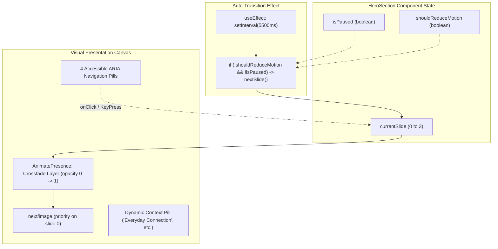

# VocalRise: Automatic Hero Photography Carousel Implementation Plan

**Plan Version:** 1.0.0  
**Date:** November 6, 2026  
**Status:** Proposal — Awaiting Explicit User Approval  
**Target Component:** [`src/components/home/HeroSection.tsx`](file:///home/harsh/Downloads/Vocal%20Rise/src/components/home/HeroSection.tsx)  
**Approved Design Spec:** [`docs/superpowers/specs/2026-11-06-vocalrise-premium-visual-redesign.md`](file:///home/harsh/Downloads/Vocal%20Rise/docs/superpowers/specs/2026-11-06-vocalrise-premium-visual-redesign.md)  
**Dependencies:** Next.js `Image`, `motion/react` (`AnimatePresence`, `motion.div`), Python Pillow (for WebP asset processing)  

---

## 1. Overview & Objectives

This plan enhances the right side of the VocalRise homepage hero section with an automatically transitioning, editorial-grade photographic carousel.

The left-hand content (headline, description, CTA buttons, and trust markers) and the right-hand practice console (waveform visualizer, microphone trigger, and floating review cards) remain **100% stationary and functional**. Only the central media frame within the product preview window transitions smoothly between 4 authentic, diverse human photographs.

### Key Requirements Checklist
- [x] 4 authentic, commercial-license photographs representing:
  1. *Everyday conversations and human connection*
  2. *Independent communication practice*
  3. *Comfortable social interactions*
  4. *Optional speech-language therapist collaboration*
- [x] Positive, dignified portrayal of diverse adults (no deficit, shame, or helplessness tropes).
- [x] Stationary headline, description, CTAs, and trust indicators.
- [x] Smooth crossfade transition between photographs (`0.7s easeInOut`).
- [x] Automatic timer interval: 5.5 seconds (5500ms).
- [x] Pause auto-transition on mouse hover (`onMouseEnter`/`onMouseLeave`) or keyboard focus (`onFocusCapture`/`onBlurCapture`).
- [x] Universal `prefers-reduced-motion` compliance: static image, timer disabled, duration 0.
- [x] Accessible navigation controls (4 pill buttons with `aria-label`, `aria-current`, keyboard focusable).
- [x] First image priority loading (`priority={true}`), subsequent images lazy loaded.
- [x] Zero Cumulative Layout Shift (CLS) via fixed aspect ratio container.

---

## 2. Photographic Asset Specifications

All photographs are sourced with verified commercial free-use licenses, cropped to a 3:2 aspect ratio, and converted into highly optimized WebP format (target: 800x533px, ~45–60 KB each) using Python Pillow:

| Slide # | Theme & Subject | File Path | Aspect Ratio | Dimensions | Alt Text |
| :---: | :--- | :--- | :---: | :---: | :--- |
| **01** | **Everyday Conversations & Human Connection:**<br>Two diverse adults in natural conversation in a warmly lit café setting, smiling with genuine ease. | `/images/hero/carousel-1-conversation.webp` | 3:2 | 800x533px | "Two adults engaged in natural, relaxed everyday conversation in a warmly lit setting" |
| **02** | **Independent Practice:**<br>Individual in a calm, modern living room or study space, speaking with relaxed posture and physical ease. | `/images/hero/carousel-2-practice.webp` | 3:2 | 800x533px | "Individual practicing speech techniques independently in a calm personal space" |
| **03** | **Comfortable Social Interactions:**<br>A diverse group in a friendly, relaxed gathering, participating comfortably without avoidance. | `/images/hero/carousel-3-social.webp` | 3:2 | 800x533px | "Diverse adults communicating comfortably and connecting in a positive social gathering" |
| **04** | **Optional SLT Collaboration:**<br>Supportive consultation between a qualified Speech-Language Therapist and a client in a modern setting. | `/images/hero/carousel-4-therapist.webp` | 3:2 | 800x533px | "Speech-Language Therapist consulting supportively with a client in a modern clinic setting" |

---

## 3. Component Architecture & State Management



### Detailed State Logic:
1. **Auto-Play Timer:**
   ```ts
   React.useEffect(() => {
     if (shouldReduceMotion || isPaused) return;

     const interval = setInterval(() => {
       setCurrentSlide((prev) => (prev + 1) % slides.length);
     }, 5500);

     return () => clearInterval(interval);
   }, [shouldReduceMotion, isPaused, slides.length]);
   ```
2. **Hover & Focus Listeners:**
   Placed on the outer carousel wrapper:
   - `onMouseEnter={() => setIsPaused(true)}`
   - `onMouseLeave={() => setIsPaused(false)}`
   - `onFocusCapture={() => setIsPaused(true)}`
   - `onBlurCapture={() => setIsPaused(false)}`
3. **Reduced Motion Graceful Degradation:**
   - When `shouldReduceMotion === true`, `currentSlide` remains locked at `0`.
   - The interval timer is completely bypassed.
   - All motion crossfade transitions execute with `duration: 0`.

---

## 4. Visual Layout & Accessibility Structure

### 4.1 Photographic Frame Layout
- Replaces the current static SVG `<Image src="/images/hero/candid-speaker.svg" />` at lines 408–428 in `src/components/home/HeroSection.tsx`.
- Container classes: `relative w-full h-[250px] sm:h-[300px] rounded-2xl overflow-hidden bg-gradient-to-br from-mist/70 via-porcelain to-white dark:from-midnight dark:via-midnight-surface dark:to-midnight-deep border border-[#D5E1E6]/70 dark:border-[#304653]/70`.
- Images render with `fill`, `object-cover`, and `sizes="(max-width: 768px) 100vw, 520px"`.
- A subtle gradient scrim overlay (`bg-gradient-to-t from-black/50 via-transparent to-black/20`) ensures the manual navigation indicators and contextual pills remain readable over any photograph.

### 4.2 Accessible Manual Controls
- Embedded at the bottom center of the photograph frame:
  ```tsx
  <div 
    role="tablist" 
    aria-label="Hero photograph carousel controls"
    className="absolute bottom-3 left-1/2 -translate-x-1/2 z-20 flex items-center gap-2 px-3 py-1.5 rounded-full bg-midnight/70 backdrop-blur-md border border-white/20"
  >
    {slides.map((slide, idx) => (
      <button
        key={slide.id}
        role="tab"
        aria-selected={currentSlide === idx}
        aria-label={`Slide ${idx + 1} of ${slides.length}: ${slide.badge}`}
        onClick={() => setCurrentSlide(idx)}
        className={cn(
          "h-2 rounded-full transition-all duration-300 focus-visible:outline-none focus-visible:ring-2 focus-visible:ring-[#38B2A3] focus-visible:ring-offset-1",
          currentSlide === idx 
            ? "w-6 bg-white" 
            : "w-2 bg-white/50 hover:bg-white/80"
        )}
      />
    ))}
  </div>
  ```

### 4.3 Preserved Existing Hero Elements
- **Docked Real-Time Waveform Console:** Positioned immediately underneath the photo frame, retaining the microphone trigger, "Recording in memory", and live waveform bars.
- **Top Window Chrome:** Browser tab indicators and "Active" pill.
- **Floating Card 1:** Clinician review deck (top right).
- **Floating Card 2:** Today's practice routine (bottom left).
- **Left Column:** Headline, description, dual CTAs, clinician link, and trust badges.

---

## 5. Scope of Affected Files

1. **Asset Files to Create:**
   - `public/images/hero/carousel-1-conversation.webp`
   - `public/images/hero/carousel-2-practice.webp`
   - `public/images/hero/carousel-3-social.webp`
   - `public/images/hero/carousel-4-therapist.webp`
2. **Component to Update:**
   - [`src/components/home/HeroSection.tsx`](file:///home/harsh/Downloads/Vocal%20Rise/src/components/home/HeroSection.tsx) (Update media container to the photographic carousel).
3. **Zero Other Files Modified:**
   - No route changes, no page changes, no package additions.

---

## 6. Verification Steps (Post-Approval)

1. **Production Build:** Execute `npm run build` and ensure exit code 0 across all 14 routes.
2. **Auto-Transition Test:** Verify images smoothly crossfade every 5.5s on desktop and mobile.
3. **Pause on Hover/Focus:** Hover over the image area and verify transitions freeze. Tab to a navigation dot and verify auto-play pauses.
4. **Manual Navigation:** Click each dot to confirm instantaneous transition to the selected slide.
5. **Reduced Motion Test:** Enable `prefers-reduced-motion` in browser/system settings and verify the carousel stays static on Slide 1 without timer triggers or motion.
6. **LCP & Performance:** Verify slide 1 has `priority={true}` and loads with zero layout shift (CLS < 0.05).
7. **Code Quality:** Run `git diff --check`.
8. **Git Commit:** Commit separately under `mayanktr127 <mayanktr127@gmail.com>`.

