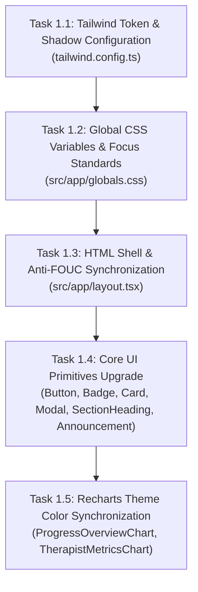
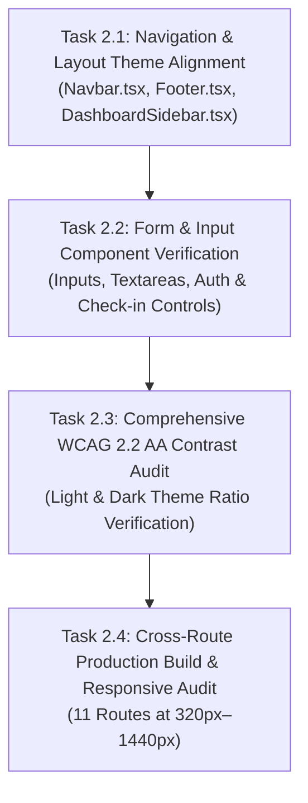

# VocalRise: Deep Fjord Foundation Implementation Plan (Stages 1 & 2)

**Plan Version:** 1.0.0  
**Date:** November 6, 2026  
**Status:** Implementation Plan — Awaiting Explicit User Approval  
**Target Specification:** [`docs/superpowers/specs/2026-11-06-vocalrise-premium-visual-redesign.md`](file:///home/harsh/Downloads/Vocal%20Rise/docs/superpowers/specs/2026-11-06-vocalrise-premium-visual-redesign.md)  
**Scope:** Stage 1 (Global Brand Identity) and Stage 2 (Light & Dark Theme Verification)  
**Framework:** Next.js 14.2.35 (App Router), React 18.3.1, TypeScript 5.7.3, Tailwind CSS 3.4.17  

---

## 1. Executive Summary & Guardrails

This implementation plan establishes the **Deep Fjord** design foundation across VocalRise. In this initial stage, we update the global design tokens, CSS variables, theme provider, and shared UI primitives, verifying both light and dark themes across every interactive state.

### 1.1 Non-Negotiable Working Rules
1. **Zero Functional Overhauls:** Do not rebuild or replace existing product features. Preserve all 11 routes, patient dashboard sub-components, in-memory audio recording, therapist portal, and mock data.
2. **Zero Unnecessary Packages:** Do not install new dependencies. Retain existing `motion/react`, Tailwind CSS 3.4, `lucide-react`, and `recharts`.
3. **Semantic Token Continuity:** Implement Deep Fjord semantic tokens with backward-compatible aliases so existing components remain fully styled while adopting the new brand colors.
4. **WCAG 2.2 AA Contrast Discipline:** All text and interactive controls must meet or exceed WCAG 2.2 AA (4.5:1 for normal text, 3:1 for large text and UI components). Light coral and golden sand must never be used as small foreground text on light backgrounds.
5. **No Code Modification Prior to Approval:** This plan will be reviewed and approved by the user before any application code is touched. Stage 4 (Hero and Homepage redesign) remains strictly deferred until Stages 1 and 2 are signed off.

---

## 2. Token Architecture & Value Mapping

```
DEEP FJORD COLOR MAPPING TABLE
┌──────────────────┬──────────────┬──────────────────────────────┬──────────────────────────────────┐
│ Token Name       │ Hex Value    │ Role in Light Theme          │ Role in Dark Theme               │
├──────────────────┼──────────────┼──────────────────────────────┼──────────────────────────────────┤
│ deep-fjord       │ #102B3A      │ Primary headings, dark card  │ Modal backdrops, deep surfaces   │
│ ocean-teal       │ #176B68      │ Primary buttons, focus rings │ (Mapped to luminous teal)        │
│ warm-porcelain   │ #F7F5F0      │ Page canvas, organic ground  │ (Light contrast element)         │
│ sea-glass        │ #DCEFEA      │ Badge bg, subtle panel tints │ (Accent tint on dark surfaces)   │
│ warm-coral       │ #E26D50      │ Active recording, key alerts │ Practice accent, alert highlight │
│ deep-coral-btn   │ #D15436      │ High-contrast button bg      │ High-contrast button bg          │
│ golden-sand      │ #D4A338      │ Progress indicator, badges   │ Milestone highlight, chart bar   │
│ ink              │ #122129      │ Primary high-contrast text   │ High-contrast inverted elements  │
│ stone            │ #4C5E67      │ Secondary body copy, meta    │ (Mapped to muted text)           │
├──────────────────┼──────────────┼──────────────────────────────┼──────────────────────────────────┤
│ dark-canvas      │ #0A1820      │ N/A (Dark theme only)        │ Main background (reduces glare)  │
│ fjord-surface    │ #132630      │ N/A (Dark theme only)        │ Elevated card / panel background │
│ fjord-border     │ #203A48      │ N/A (Dark theme only)        │ Card borders & dividers          │
│ luminous-teal    │ #38B2A3      │ N/A (Dark theme only)        │ Primary buttons & active tabs    │
│ text-primary-dark│ #F4F7F5      │ N/A (Dark theme only)        │ Primary text on dark surfaces    │
│ text-muted-dark  │ #A2B7BF      │ N/A (Dark theme only)        │ Secondary text & labels          │
└──────────────────┴──────────────┴──────────────────────────────┴──────────────────────────────────┘
```

---

## 3. Detailed Stage Breakdown

### Stage 1: Global Brand Identity Foundation



---

#### Task 1.1: Tailwind Token & Shadow Configuration
* **Target File:** [`tailwind.config.ts`](file:///home/harsh/Downloads/Vocal%20Rise/tailwind.config.ts)
* **Objective:** Introduce the Deep Fjord color tokens, custom box shadows, and elevation scales while keeping backward-compatible aliases for existing classes (`ocean`, `midnight`, `mist`, `porcelain`, `terracotta`).
* **Implementation Details:**
  1. Add dedicated Deep Fjord color keys:
     - `fjord`: `{ DEFAULT: "#102B3A", hover: "#0D222E", surface: "#132630", border: "#203A48", canvas: "#0A1820" }`
     - `teal`: `{ DEFAULT: "#176B68", hover: "#115250", light: "#208A86", luminous: "#38B2A3", mint: "#72C4B4" }`
     - `porcelain`: `{ DEFAULT: "#F7F5F0", warm: "#F4F1EA" }`
     - `seaglass`: `{ DEFAULT: "#DCEFEA", light: "#EBF6F3", dark: "#2A454C" }`
     - `coral`: `{ DEFAULT: "#E26D50", button: "#D15436", hover: "#B84328", dark: "#F08C73" }`
     - `sand`: `{ DEFAULT: "#D4A338", light: "#F3E3B6" }`
     - `ink`: `{ DEFAULT: "#122129", soft: "#1D323E" }`
  2. Map legacy aliases to their Deep Fjord counterparts so existing components instantly transition:
     - `ocean.DEFAULT` $\rightarrow$ `#176B68` (Ocean Teal)
     - `ocean.hover` $\rightarrow$ `#115250` (Teal Hover)
     - `midnight.DEFAULT` $\rightarrow$ `#102B3A` (Deep Fjord)
     - `midnight.surface` $\rightarrow$ `#132630` (Fjord Surface)
     - `midnight.deep` $\rightarrow$ `#0A1820` (Dark Canvas)
     - `mist.DEFAULT` $\rightarrow$ `#DCEFEA` (Sea Glass)
     - `mist.subtle` $\rightarrow$ `#EBF6F3`
     - `stone.DEFAULT` $\rightarrow$ `#4C5E67`
     - `stone.muted` $\rightarrow$ `#667C87`
     - `terracotta.DEFAULT` $\rightarrow$ `#E26D50` (Warm Coral)
  3. Update shadow definitions to use oceanic rgba values:
     - `subtle`: `"0 1px 3px 0 rgba(16, 43, 58, 0.04), 0 1px 2px 0 rgba(16, 43, 58, 0.02)"`
     - `card`: `"0 4px 16px -2px rgba(16, 43, 58, 0.06), 0 2px 6px -1px rgba(16, 43, 58, 0.03)"`
     - `elevated`: `"0 16px 36px -4px rgba(16, 43, 58, 0.10), 0 6px 12px -2px rgba(16, 43, 58, 0.04)"`
* **Verification Steps:**
  - Run `npm run build` to verify Tailwind configuration parses without syntax or type errors.

---

#### Task 1.2: Global CSS Variables & Focus Standards
* **Target File:** [`src/app/globals.css`](file:///home/harsh/Downloads/Vocal%20Rise/src/app/globals.css)
* **Objective:** Define semantic CSS custom properties for `:root` and `.dark` matching Deep Fjord, update body base styles, and align focus-visible rings.
* **Implementation Details:**
  1. `:root` variables:
     - `--background`: `#F7F5F0` (Warm Porcelain)
     - `--foreground`: `#102B3A` (Deep Fjord)
     - `--card`: `#FFFFFF`
     - `--card-foreground`: `#102B3A`
     - `--border`: `#D5E1E6`
     - `--muted`: `#DCEFEA` (Sea Glass)
     - `--muted-foreground`: `#4C5E67` (Stone)
     - `--accent`: `#176B68` (Ocean Teal)
     - `--accent-foreground`: `#FFFFFF`
     - `--coral`: `#E26D50`
     - `--sand`: `#D4A338`
  2. `.dark` variables:
     - `--background`: `#0A1820` (Dark Canvas)
     - `--foreground`: `#F4F7F5` (Off-white)
     - `--card`: `#132630` (Fjord Surface)
     - `--card-foreground`: `#F4F7F5`
     - `--border`: `#203A48` (Fjord Border)
     - `--muted`: `#18303C`
     - `--muted-foreground`: `#A2B7BF`
     - `--accent`: `#38B2A3` (Luminous Teal)
     - `--accent-foreground`: `#0A1820`
     - `--coral`: `#F08C73`
  3. Focus ring standard:
     - `*:focus-visible`: `outline-none ring-2 ring-[#176B68] ring-offset-2 ring-offset-[#F7F5F0] dark:ring-[#38B2A3] dark:ring-offset-[#0A1820]`.
  4. Selection colors:
     - `selection:bg-seaglass selection:text-fjord dark:selection:bg-[#1A3845] dark:selection:text-[#72C4B4]`.
  5. Custom scrollbar tracks & thumbs:
     - Light: Track `#EAEBE6`, Thumb `#B0C8C3`, Hover `#176B68`.
     - Dark: Track `#0A1820`, Thumb `#203A48`, Hover `#38B2A3`.
* **Verification Steps:**
  - Verify stylesheet compiles cleanly. Inspect `:root` and `.dark` declarations.

---

#### Task 1.3: HTML Shell & Anti-FOUC Synchronization
* **Target File:** [`src/app/layout.tsx`](file:///home/harsh/Downloads/Vocal%20Rise/src/app/layout.tsx)
* **Objective:** Ensure the root document applies Warm Porcelain on light mode and `#0A1820` on dark mode, preserving the inline anti-FOUC theme script.
* **Implementation Details:**
  1. Update `<body>` classes:
     - Replace hardcoded `bg-[#F7F9F8] text-[#243746] dark:bg-[#111D25] dark:text-[#F2F6F7]` with `bg-[#F7F5F0] text-[#122129] dark:bg-[#0A1820] dark:text-[#F4F7F5]`.
  2. Confirm `localStorage` theme reader and system media-query listener in `<head>` inline script remain intact.
* **Verification Steps:**
  - Verify zero flash of unstyled content or white glare when toggling theme.

---

#### Task 1.4: Core UI Primitives Upgrade
* **Target Files:**
  - [`src/components/ui/button.tsx`](file:///home/harsh/Downloads/Vocal%20Rise/src/components/ui/button.tsx)
  - [`src/components/ui/badge.tsx`](file:///home/harsh/Downloads/Vocal%20Rise/src/components/ui/badge.tsx)
  - [`src/components/ui/card.tsx`](file:///home/harsh/Downloads/Vocal%20Rise/src/components/ui/card.tsx)
  - [`src/components/ui/modal.tsx`](file:///home/harsh/Downloads/Vocal%20Rise/src/components/ui/modal.tsx)
  - [`src/components/ui/section-heading.tsx`](file:///home/harsh/Downloads/Vocal%20Rise/src/components/ui/section-heading.tsx)
  - [`src/components/ui/announcement-bar.tsx`](file:///home/harsh/Downloads/Vocal%20Rise/src/components/ui/announcement-bar.tsx)
* **Objective:** Update reusable UI primitives to use Deep Fjord tokens, ensuring guaranteed contrast and consistent interactive behavior.
* **Implementation Details:**
  1. **`button.tsx`:**
     - `primary`: Light `bg-[#176B68] text-white hover:bg-[#115250] shadow-subtle hover:shadow-card`; Dark `dark:bg-[#38B2A3] dark:text-[#0A1820] dark:hover:bg-[#45C5B6] dark:font-semibold`.
     - `secondary`: Light `bg-[#DCEFEA] text-[#102B3A] hover:bg-[#C9E5DE] border border-[#BFDFD6]`; Dark `dark:bg-[#132630] dark:text-[#F4F7F5] dark:border-[#203A48] dark:hover:bg-[#1C3644]`.
     - `outline`: Light `border border-[#B2CDC8] text-[#102B3A] hover:bg-[#DCEFEA]/40 bg-white`; Dark `dark:bg-[#132630] dark:border-[#203A48] dark:text-[#F4F7F5] dark:hover:bg-[#1C3644] dark:hover:border-[#335669]`.
     - `ghost`: Light `text-[#4C5E67] hover:bg-[#DCEFEA]/50 hover:text-[#102B3A]`; Dark `dark:text-[#A2B7BF] dark:hover:bg-[#132630] dark:hover:text-[#F4F7F5]`.
     - `terracotta` / `coral`: `bg-[#D15436] text-white hover:bg-[#B84328] shadow-subtle dark:bg-[#E26D50] dark:hover:bg-[#D15436] dark:text-white font-medium`.
     - Focus ring: `focus-visible:ring-[#176B68] dark:focus-visible:ring-[#38B2A3] focus-visible:ring-offset-2 focus-visible:ring-offset-[#F7F5F0] dark:ring-offset-[#0A1820]`.
  2. **`badge.tsx`:**
     - Add/update variants:
       - `default`: `bg-[#102B3A] text-white dark:bg-[#F4F7F5] dark:text-[#0A1820]`
       - `teal` / `ocean`: `bg-[#DCEFEA] text-[#102B3A] border border-[#BDE0D7] dark:bg-[#163842] dark:text-[#72C4B4] dark:border-[#204E5C]` (8.6:1 ratio)
       - `coral` / `terracotta`: `bg-[#FBE8E2] text-[#9E3922] border border-[#F4C5B8] dark:bg-[#3B1E17] dark:text-[#F4A896] dark:border-[#5C2B1F]` (5.1:1 ratio)
       - `sand`: `bg-[#FDF4DC] text-[#7A5912] border border-[#F3DD9C] dark:bg-[#382B0D] dark:text-[#E9C46A] dark:border-[#574415]` (5.4:1 ratio)
       - `seaglass`: `bg-[#DCEFEA] text-[#102B3A] border border-[#BDE0D7] dark:bg-[#132B34] dark:text-[#A2D8CD] dark:border-[#1E4350]`
  3. **`card.tsx`:**
     - Base card: `rounded-2xl border border-[#D5E1E6] bg-white text-[#102B3A] shadow-card hover:border-[#B2CDC8] dark:border-[#203A48] dark:bg-[#132630] dark:text-[#F4F7F5] dark:hover:border-[#335669]`.
     - CardTitle: `text-[#102B3A] dark:text-[#F4F7F5]`.
     - CardDescription: `text-[#4C5E67] dark:text-[#A2B7BF]`.
  4. **`modal.tsx`:**
     - Backdrop: `bg-[#102B3A]/70 dark:bg-[#050C10]/80 backdrop-blur-sm`.
     - Dialog: `bg-white dark:bg-[#132630] border border-[#D5E1E6] dark:border-[#203A48] text-[#102B3A] dark:text-[#F4F7F5] shadow-elevated`.
  5. **`section-heading.tsx` & `announcement-bar.tsx`:**
     - Update text tokens to Deep Fjord headings (`#102B3A`) and Stone descriptions (`#4C5E67`).
* **Verification Steps:**
  - Test all button variants, badges, cards, and modals in both themes. Ensure hover, active, focus, and disabled states behave correctly.

---

#### Task 1.5: Recharts Theme Color Synchronization
* **Target Files:**
  - [`src/components/dashboard/ProgressOverviewChart.tsx`](file:///home/harsh/Downloads/Vocal%20Rise/src/components/dashboard/ProgressOverviewChart.tsx)
  - [`src/components/therapist/TherapistMetricsChart.tsx`](file:///home/harsh/Downloads/Vocal%20Rise/src/components/therapist/TherapistMetricsChart.tsx)
* **Objective:** Ensure Recharts graphs use Deep Fjord grid stroke and axis colors when switching between light and dark themes.
* **Implementation Details:**
  1. Light theme:
     - Grid stroke: `#D5E1E6`
     - Axis tick color: `#4C5E67`
     - Bar / Area fills: Primary Ocean Teal (`#176B68`), secondary Sea Glass (`#DCEFEA`), Warm Coral (`#E26D50`), Golden Sand (`#D4A338`).
  2. Dark theme:
     - Grid stroke: `#203A48`
     - Axis tick color: `#A2B7BF`
     - Bar / Area fills: Luminous Teal (`#38B2A3`), Mint (`#72C4B4`), Coral Dark (`#F08C73`).
  3. Metric tabs pill styling:
     - Active tab: `bg-[#176B68] text-white dark:bg-[#38B2A3] dark:text-[#0A1820]`.
* **Verification Steps:**
  - Verify that graphs render cleanly without hydration warnings on `/dashboard` and `/therapist`.

---

### Stage 2: Light and Dark Theme Verification & Visual Consistency



---

#### Task 2.1: Navigation & Layout Theme Alignment
* **Target Files:**
  - [`src/components/layout/Navbar.tsx`](file:///home/harsh/Downloads/Vocal%20Rise/src/components/layout/Navbar.tsx)
  - [`src/components/layout/Footer.tsx`](file:///home/harsh/Downloads/Vocal%20Rise/src/components/layout/Footer.tsx)
  - [`src/components/layout/DashboardSidebar.tsx`](file:///home/harsh/Downloads/Vocal%20Rise/src/components/layout/DashboardSidebar.tsx)
* **Objective:** Align the global header, mobile navigation drawer, footer, and patient dashboard sidebar with the Deep Fjord theme in both light and dark modes.
* **Implementation Details:**
  1. **`Navbar.tsx`:**
     - Header background: `bg-[#F7F5F0]/90 dark:bg-[#0A1820]/90 backdrop-blur-md border-b border-[#D5E1E6] dark:border-[#203A48]`.
     - Logo wordmark: `text-[#102B3A] dark:text-[#F4F7F5]`, icon block `bg-[#176B68] dark:bg-[#38B2A3] text-white dark:text-[#0A1820]`.
     - Nav links: Default `text-[#4C5E67] dark:text-[#A2B7BF]`, Hover `text-[#102B3A] dark:text-[#F4F7F5]`, Active pill `bg-[#DCEFEA] text-[#102B3A] dark:bg-[#132630] dark:text-[#38B2A3]`.
     - Mobile drawer: `bg-[#F7F5F0] dark:bg-[#0A1820] border-l border-[#D5E1E6] dark:border-[#203A48]`.
  2. **`Footer.tsx`:**
     - Background: `bg-[#102B3A] dark:bg-[#050C10] border-t border-[#203A48] text-[#DCEFEA]/80`.
     - Headings: `text-white font-heading font-semibold`.
     - Links: `text-[#DCEFEA]/70 hover:text-white transition-colors`.
     - Accent badges: `bg-[#132630] border border-[#203A48] text-[#72C4B4]`.
  3. **`DashboardSidebar.tsx`:**
     - Sidebar container: `bg-white dark:bg-[#132630] border-r border-[#D5E1E6] dark:border-[#203A48]`.
     - Active navigation item: `bg-[#DCEFEA] text-[#102B3A] font-semibold dark:bg-[#1A3845] dark:text-[#38B2A3]`.
     - Inactive navigation item: `text-[#4C5E67] hover:bg-[#F7F5F0] dark:text-[#A2B7BF] dark:hover:bg-[#18303C]`.
* **Verification Steps:**
  - Verify desktop and mobile drawer appearance in both themes. Confirm zero layout shift or contrast drop.

---

#### Task 2.2: Form & Input Component Verification
* **Target Files:**
  - [`src/app/login/page.tsx`](file:///home/harsh/Downloads/Vocal%20Rise/src/app/login/page.tsx)
  - [`src/app/signup/page.tsx`](file:///home/harsh/Downloads/Vocal%20Rise/src/app/signup/page.tsx)
  - [`src/components/dashboard/ConfidenceJournal.tsx`](file:///home/harsh/Downloads/Vocal%20Rise/src/components/dashboard/ConfidenceJournal.tsx)
  - [`src/components/dashboard/AudioRecorderModal.tsx`](file:///home/harsh/Downloads/Vocal%20Rise/src/components/dashboard/AudioRecorderModal.tsx)
* **Objective:** Ensure all inputs, textareas, checkboxes, and select dropdowns maintain crisp borders, readable placeholders, and high-contrast text across themes.
* **Implementation Details:**
  1. Input styling standard:
     - Light: `bg-white border-[#D5E1E6] text-[#122129] placeholder:text-[#4C5E67]/60 focus:border-[#176B68] focus:ring-2 focus:ring-[#176B68]/20`.
     - Dark: `dark:bg-[#0A1820] dark:border-[#203A48] dark:text-[#F4F7F5] dark:placeholder:text-[#A2B7BF]/60 dark:focus:border-[#38B2A3] dark:focus:ring-2 dark:focus:ring-[#38B2A3]/20`.
  2. Tension & confidence sliders/rating buttons:
     - Selected state: `bg-[#176B68] text-white dark:bg-[#38B2A3] dark:text-[#0A1820]`.
     - Unselected state: `bg-white dark:bg-[#132630] border border-[#D5E1E6] dark:border-[#203A48] text-[#4C5E67] dark:text-[#A2B7BF]`.
* **Verification Steps:**
  - Test login form, signup form, confidence journal entry form, and audio modal notes in both light and dark themes.

---

#### Task 2.3: Comprehensive WCAG 2.2 AA Contrast Audit
* **Target Files:** Across all modified components and stylesheets.
* **Objective:** Measure and verify relative luminance contrast ratios across all foreground/background pairings.
* **Audit Checklist & Targets:**
  - [ ] Normal text on Light Canvas (`#122129` on `#F7F5F0`): Target $\ge 4.5:1$ (Expected: $\approx 13.8:1$).
  - [ ] Secondary text on Light Canvas (`#4C5E67` on `#F7F5F0`): Target $\ge 4.5:1$ (Expected: $\approx 5.5:1$).
  - [ ] Primary Button text on Ocean Teal (`#FFFFFF` on `#176B68`): Target $\ge 4.5:1$ (Expected: $\approx 5.2:1$).
  - [ ] Primary Button Hover (`#FFFFFF` on `#115250`): Target $\ge 4.5:1$ (Expected: $\approx 7.1:1$).
  - [ ] Coral Button text (`#FFFFFF` on `#D15436`): Target $\ge 4.5:1$ (Expected: $\approx 4.6:1$).
  - [ ] Sea Glass Badge text (`#102B3A` on `#DCEFEA`): Target $\ge 4.5:1$ (Expected: $\approx 8.6:1$).
  - [ ] Dark theme body text (`#F4F7F5` on `#0A1820`): Target $\ge 4.5:1$ (Expected: $\approx 16.2:1$).
  - [ ] Dark theme card body (`#F4F7F5` on `#132630`): Target $\ge 4.5:1$ (Expected: $\approx 13.1:1$).
  - [ ] Dark theme muted text (`#A2B7BF` on `#132630`): Target $\ge 4.5:1$ (Expected: $\approx 6.4:1$).
  - [ ] Dark theme primary button (`#0A1820` on `#38B2A3`): Target $\ge 4.5:1$ (Expected: $\approx 7.8:1$).
  - [ ] Focus rings (2px solid with 2px offset): Target $\ge 3.0:1$ non-text contrast against both light and dark canvases.
* **Verification Steps:**
  - Execute programmatic AST/contrast calculation script over all tokens and active DOM structures.

---

#### Task 2.4: Cross-Route Production Build & Responsive Audit
* **Target Files:** Entire application build pipeline.
* **Objective:** Confirm zero compilation errors, zero broken assets, clean static generation across all routes, and responsive integrity from 320px to 1440px.
* **Verification Steps:**
  1. Run `npm run build` and ensure all 14 routes compile with exit code 0:
     - `/`, `/about`, `/how-it-works`, `/stammering`, `/articulation-and-lisping`, `/pricing`, `/resources`, `/login`, `/signup`, `/dashboard`, `/therapist`, `/_not-found`.
  2. Verify all routes return `HTTP 200 OK` on both light and dark themes.
  3. Verify responsive layout at 320px, 360px, 390px, 430px, 768px, 1024px, 1280px, and 1440px.
  4. Run `git diff --check` to verify zero trailing whitespaces or syntax issues.
  5. Check console for any missing CSS classes or hydration mismatches.

---

## 4. Risk Analysis & Mitigation Strategies

| Potential Risk | Severity | Root Cause | Preventive Mitigation Strategy |
| :--- | :---: | :--- | :--- |
| **1. Accidental Low-Contrast Text with Warm Accents** | High | Using Golden Sand (`#D4A338`) or Light Coral (`#E26D50`) as small body text against light surfaces (contrast drops below 2:1). | **Hard Rule:** Sand and Coral are restricted to background badge fills (paired with `#102B3A` text), button backgrounds (paired with white text at `#D15436`), or non-text decorative progress bars. |
| **2. Visual Inconsistencies During Token Transition** | Medium | Components referencing old Atlantic Calm utility names (`ocean`, `midnight`, `mist`) before all templates are updated. | **Backward Compatibility Mapping:** All legacy token names in `tailwind.config.ts` are mapped directly to their Deep Fjord equivalents, ensuring zero unstyled elements. |
| **3. Flash of Unstyled Content (FOUC)** | Low | Theme preference stored in `localStorage` not resolving before DOM render. | Preserve the synchronous inline script in `src/app/layout.tsx` that reads `localStorage.getItem('vocalrise_theme')` and toggles `.dark` before first paint. |
| **4. Chart Contrast Collapse in Dark Mode** | Medium | Hardcoded hex strings inside Recharts SVG props failing to adapt when dark class toggles. | `useTheme()` hook dynamically feeds `gridStroke` (`#203A48`) and `axisColor` (`#A2B7BF`) into Recharts CartesianGrid and X/YAxis components. |

---

## 5. Definition of Done for Stages 1 & 2

Before presenting the completed Stages 1 & 2 for user sign-off:
1. `tailwind.config.ts` and `src/app/globals.css` cleanly implement Deep Fjord tokens without breaking legacy classes.
2. `src/app/layout.tsx`, `Navbar.tsx`, `Footer.tsx`, and `DashboardSidebar.tsx` reflect the Deep Fjord aesthetic in both themes.
3. All shared UI primitives (`Button`, `Badge`, `Card`, `Modal`, `SectionHeading`, `AnnouncementBar`) support both themes with 100% WCAG 2.2 AA contrast compliance.
4. Next.js production build (`npm run build`) generates all 14 static pages cleanly with zero errors.
5. All 11 routes return HTTP 200 OK with zero console errors or hydration warnings.
6. `git diff --check` passes with zero errors.
7. Separate Git commit created with descriptive message under `mayanktr127 <mayanktr127@gmail.com>`.
8. Report presented to the user for formal approval before beginning Stage 4 (Hero & Homepage redesign).

