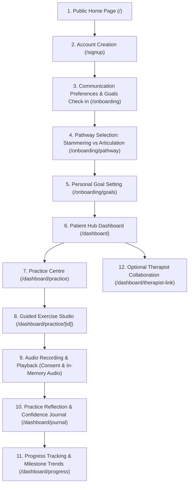
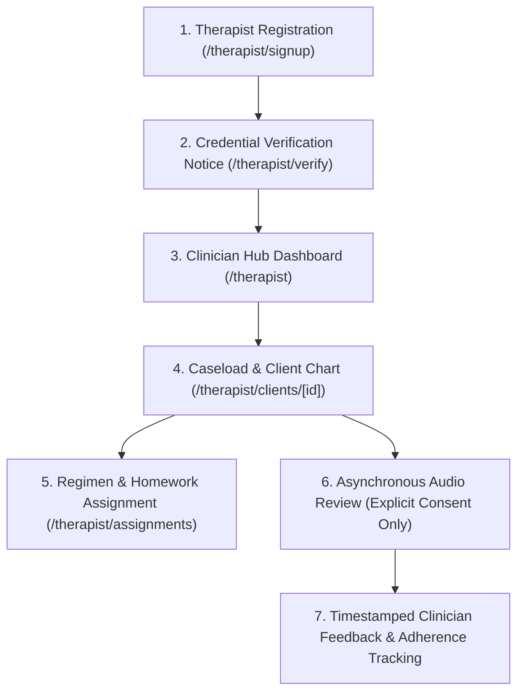
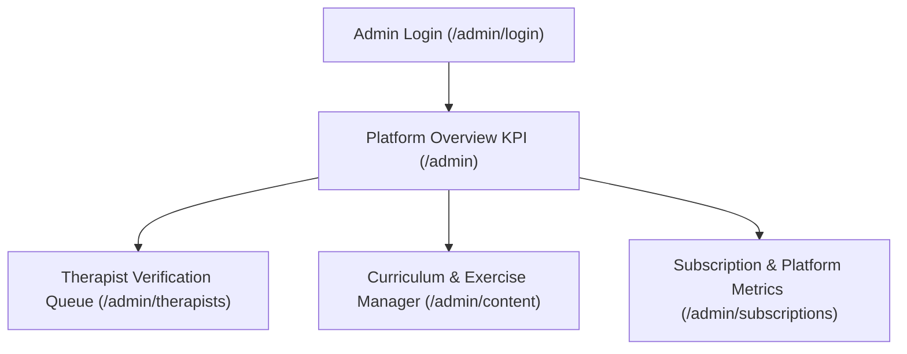
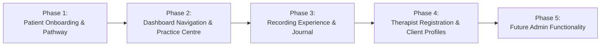

# VocalRise: Master Product Design Specification & Architecture Blueprint

**Document Version:** 1.0.0  
**Date:** November 5, 2026  
**Status:** Consolidated Design Specification (Awaiting Final Approval)  
**Target Environment:** Next.js 14 App Router, TypeScript, Tailwind CSS, shadcn/ui, Lucide Icons, Recharts  

---

## 1. Executive Summary & Problem Statement

### 1.1 The Problem
People with speech variations or articulation needs face unique emotional, psychological, and clinical challenges:
- **Speech Vulnerability & Anxiety:** Individuals who stammer frequently encounter social stigma, anxiety, and avoidance behaviors. Generic speech apps often treat stammering as a failure of pronunciation or enforce rigid fluency drills, inducing shame rather than fostering agency.
- **Articulation & Placement Barriers:** Those with articulation difficulties or lisps require structured motor-phonetic guidance (visual cues, acoustic repetition, auditory discrimination), which differs fundamentally from fluency modulation.
- **Between-Session Cliff:** Speech therapy with a certified Speech-Language Therapist (SLT / CCC-SLP) typically occurs once weekly or bi-weekly. Patients often struggle to maintain structured home practice without feedback, while clinicians lack insight into real-world adherence and emotional response.

### 1.2 The VocalRise Solution
**VocalRise** is a calm, trustworthy, premium health-tech SaaS web platform designed to bridge the gap between clinical appointments and daily life. It empowers individuals to practice speech techniques, track participation milestones, and optionally collaborate with licensed speech therapists.

VocalRise is **not**:
- A generic AI chatbot.
- A quick-fix tool promising to "cure" speech variations.
- An automated diagnostic medical device.

Instead, VocalRise provides an emotionally safe, neurodiversity-affirming practice space built around personal communication goals, self-advocacy, motor-phonetic drills, and clinician-partnered continuity of care.

---

## 2. Core Clinical & Ethical Guardrails

Every user interface, copy string, and data model in VocalRise must adhere to these non-negotiable principles:

### 2.1 Non-Diagnostic Onboarding: "Communication Preferences & Goals Check-in"
- The initial user onboarding must **never** be labeled or structured as a "clinical assessment," "diagnostic test," or "severity grading."
- It is explicitly termed a **"Communication Preferences and Goals Check-in."**
- It gathers subjective self-reports: comfort in daily speaking situations (e.g., ordering coffee, phone calls, team meetings), personal aspirations, and preferred practice style.
- Welcoming, encouraging language is maintained throughout, eliminating clinical intimidation.

### 2.2 Strict Pathway Separation
VocalRise maintains two distinct, un-conflated practice tracks:
1. **Stammering Support Track:**
   - Grounded in modern fluency modification, voluntary stuttering (desensitization), gentle onset, and acceptance-based communication.
   - **Crucial Rule:** Stammering is **never** presented as incorrect pronunciation or a physical articulation flaw.
   - **No Forced Fluency Assumption:** VocalRise does **not** assume that every user who stammers aims to eliminate stammering or achieve 100% fluent speech. Success includes speaking with ease, reducing physical tension, showing up to conversations, self-advocating, and building unshakeable confidence.
2. **Articulation & Lisping Support Track:**
   - Grounded in motor-speech and phonetic placement therapy (e.g., frontal/interdental lisp, lateral lisp, /r/ vocalic placement).
   - Structured around a progressive drill hierarchy: isolation, syllables, words, carrier phrases, and conversational reading.
   - Focuses on tongue placement, airflow dynamics, and acoustic contrast.

### 2.3 Transparent AI & Measurement Boundaries
- Automated feedback or visual waveforms are strictly characterized as **"Practice Assistance & Acoustic Feedback."**
- The platform **never** displays fabricated clinical measurements (e.g., "Fluency Score: 87.4%", "Stuttering Severity Rating: Severe").
- Any feedback generated by future AI or algorithmic analysis must display a clear, persistent disclaimer:  
  *“Feedback is for personal practice and self-reflection only. It does not constitute a clinical diagnosis or medical evaluation. Please consult your speech-language therapist for clinical guidance.”*

### 2.4 Prototype Integrity & Simulated Therapist Verification
- In the initial frontend prototype, all clinician approvals, verification checkmarks, and client linkage are **simulated mock features** to test user journeys.
- To prevent misleading users, the interface must clearly display prototype badges (e.g., `[Prototype Mode: Demo Account]`).
- Therapist verification status will show explicit informational notices explaining that in a production environment, national professional registries (e.g., RCSLT, ASHA, HCPC) are verified prior to activating clinician accounts.

---

## 3. User Roles & System Permissions

VocalRise defines three distinct personas:

| Role | Primary Objectives | System Access & Boundaries |
| :--- | :--- | :--- |
| **Patient / Individual** | Practice speech techniques, track confidence, record audio drills, write reflections, collaborate with an optional therapist. | • Access to personal dashboard, practice modules, confidence journal, and audio studio.<br>• Full ownership of audio recordings (explicit consent, play, share, or delete).<br>• Cannot access other patients' data or clinician caseloads. |
| **Speech-Language Therapist (SLT / SLP)** | Monitor patient home practice, review shared audio, assign practice regimens, provide timestamped notes. | • Access to therapist portal and assigned caseload.<br>• Can review patient audio **only** when explicit patient permission is granted.<br>• Cannot alter patient account credentials or access unassigned users. |
| **Administrator (Future Phase)** | Review professional credentials, maintain practice curriculum, monitor platform health and subscriptions. | • Access to admin dashboard, therapist verification queue, module editor, and user directory.<br>• Restricted from listening to private patient practice audio. |

---

## 4. End-to-End User Journeys

### 4.1 The Complete Patient Journey



#### Detailed Breakdown of Patient Steps:
1. **Home Page (`/`):** Welcoming value proposition, clinical advisory transparency, pathway explanations, WCAG AA compliance, light/dark switch.
2. **Sign Up (`/signup`):** Simple email/password creation with role selector (`Patient` vs. `Speech Therapist`). Clear privacy notice: *“Your voice data belongs to you.”*
3. **Onboarding Check-in (`/onboarding`):** A gentle, 3-question self-reflection:
   - Question 1: How do you feel about speaking in daily life right now? (Calm, Somewhat Hesitant, High Tension).
   - Question 2: Which speaking contexts matter most to you? (Work meetings, social gatherings, telephone calls, classroom discussions, ordering food).
   - Question 3: How would you like to pace your practice? (5 mins/day, 10 mins/day, weekend reviews).
4. **Pathway Selection (`/onboarding/pathway`):**
   - Option A: *Stammering / Fluency Support* (Gentle onsets, pausing, desensitization, speaking with confidence).
   - Option B: *Articulation & Lisping Support* (Tongue placement, acoustic drills for /s/, /z/, /r/, sound clarity).
   - Explicit reassurance that users can explore both or change tracks at any time.
5. **Personal Goal Setting (`/onboarding/goals`):**
   - User picks or drafts their first meaningful communication goal (e.g., *"Introduce myself with voluntary pausing during morning standup"* or *"Practice 10 clean /s/ syllables without tension"*).
   - Goals are grounded in personal participation, not mechanical perfection.
6. **Patient Hub (`/dashboard`):** Today’s recommended micro-drill, current practice streak, goal progress, quick recorder trigger, and therapist connection status.
7. **Practice Centre (`/dashboard/practice`):** Categorized library of evidence-informed exercises (e.g., Gentle Onset, Pausing & Chunking, Pull-Outs, Syllable Drills, Word Lists). Filterable by pathway, difficulty, and duration.
8. **Guided Exercise Studio (`/dashboard/practice/[id]`):** Focused practice mode with step-by-step visual cues, tongue/lip placement illustrations, technique reminders, and pacing prompts.
9. **Audio Recording & Playback:** Native browser microphone capture (`MediaRecorder`), live animated waveform visualizer, instantaneous playback, audio trim preview, and explicit share/delete toggles.
10. **Practice Reflection & Journal (`/dashboard/journal`):** Self-observation notes recorded after every drill (e.g., physical tension level 1–5, emotional state, what went well).
11. **Progress Tracking (`/dashboard/progress`):** Visual trends of practice consistency, speaking confidence over time, goal completion, and technique variety (powered by Recharts).
12. **Optional Therapist Collaboration (`/dashboard/therapist-link`):** Connect to a clinician via a secure Clinic Invite Code (e.g., `HARBOR-CHEN-2026`). Manage permissions: choose whether the therapist can hear specific recordings or only review practice completion logs.

---

### 4.2 The Complete Therapist Journey



#### Detailed Breakdown of Therapist Steps:
1. **Therapist Registration (`/therapist/signup`):** Professional onboarding collecting license/registration number (e.g., RCSLT, ASHA CCC-SLP, HCPC), clinical practice/organization name, and areas of specialization (Fluency, Motor Speech, Pediatric, Adult Neurogenic).
2. **Credential Verification Notice (`/therapist/verify`):** Reassuring pending-verification screen. Explicitly states that credentials undergo validation before real client data can be linked. In prototype mode, an interactive toggle allows evaluators to simulate approval.
3. **Clinician Hub (`/therapist`):** Overview of active caseload, upcoming reviews, high-priority notifications, practice adherence rates, and quick action bar.
4. **Client Management (`/therapist/clients/[id]`):** Comprehensive client chart displaying speech pathway, active goals, weekly practice adherence, self-reported confidence trends, and permission-granted audio submissions.
5. **Exercise Assignment (`/therapist/assignments`):** Prescribe customized practice routines, adjust drill repetitions, specify technique targets, and attach personalized clinician notes.
6. **Asynchronous Audio Review:** Waveform audio playback deck with playback speed control (0.75x, 1x, 1.25x), visual markers, and side-by-side view of the client's self-observation notes.
7. **Feedback & Progress Review:** Clinician leaves timestamped constructive feedback, celebratory encouragement, or technique adjustments that appear in the client's dashboard.

---

### 4.3 The Future Administrator Journey (Phase 5)



- **Credential Review Desk (`/admin/therapists`):** Staff review submitted clinical license numbers against official registry databases, approve or reject credentials, and flag expired credentials.
- **Curriculum CMS (`/admin/content`):** Create, update, or retire practice drills, adjust placement guides, and publish evidence-based articles for the Resources library.
- **Platform Integrity (`/admin/subscriptions`):** Manage practice tier subscriptions, user status, and aggregate platform telemetry (without compromising audio privacy).

---

## 5. Current Codebase Audit & Gap Analysis

### 5.1 Audit Table: Implemented vs. Missing Features

| Journey Step / Area | Current Status | Implemented Component / File | Missing Capabilities Needed |
| :--- | :---: | :--- | :--- |
| **Home Page** | ✅ Fully Implemented | `src/app/page.tsx`, `Navbar.tsx`, `Footer.tsx` | None. Complete, responsive, theme-ready. |
| **Informational Pages** | ✅ Fully Implemented | `how-it-works/`, `stammering/`, `articulation.../`, `about/`, `pricing/`, `resources/` | None. All 6 marketing pages complete. |
| **Auth Pages** | 🟡 Partially Implemented | `src/app/login/page.tsx`, `src/app/signup/page.tsx` | `/signup` currently skips onboarding and hard-redirects to `/dashboard`. Needs onboarding routing. |
| **Patient Onboarding Flow** | ❌ Not Implemented | *None* | Multi-step route `/onboarding`, `/onboarding/pathway`, and `/onboarding/goals` missing. |
| **Patient Dashboard Hub** | ✅ Fully Implemented | `src/app/dashboard/page.tsx`, `WelcomeSection.tsx`, `TodayPracticeCard.tsx`, `GoalsList.tsx` | Overview works well; needs sub-route integration for sidebar tabs. |
| **Practice Centre** | 🟡 Partially Implemented | `RecommendedExercises.tsx` (card on dashboard) | Dedicated full-page exercise library (`/dashboard/practice`) and drill studio route (`/dashboard/practice/[id]`). |
| **Audio Recorder Studio** | ✅ Fully Implemented | `AudioRecorderModal.tsx` | Works as a modal; needs browser `MediaRecorder` hookup and explicit audio privacy notices. |
| **Confidence Journal** | 🟡 Partially Implemented | `ConfidenceJournal.tsx` (card on dashboard) | Needs dedicated page (`/dashboard/journal`) for full historical reflection search and filter. |
| **Progress Analytics** | 🟡 Partially Implemented | `ProgressOverviewChart.tsx` (7-day chart) | Needs extended analytics view (`/dashboard/progress`) for multi-week trends and technique breakdowns. |
| **Therapist Collaboration Link** | 🟡 Partially Implemented | Visual card in `DashboardSidebar.tsx` | Dedicated link page (`/dashboard/therapist-link`) with invite code input and recording permissions toggle. |
| **Therapist Registration & Verification** | ❌ Not Implemented | *None* | Dedicated professional intake (`/therapist/signup`) and verification notice (`/therapist/verify`). |
| **Therapist Caseload Hub** | ✅ Fully Implemented | `src/app/therapist/page.tsx`, `PatientOverviewTable.tsx`, `RecordingReviewArea.tsx` | Overview works well; needs dedicated individual client file route (`/therapist/clients/[id]`). |
| **Administrator Area** | ❌ Not Implemented | *None* | Future `/admin` routes (Phase 5). |

### 5.2 Navigation Disconnects to Resolve
1. **Sidebar Navigation Disconnect:** In `DashboardSidebar.tsx`, navigation buttons (`Today's Hub`, `Practice Modules`, `Personal Goals`, `Audio Recordings`, `Confidence Journal`) currently update an internal string state without routing or switching views. These must map cleanly to dedicated sub-routes or cohesive tab views.
2. **Signup Bypass:** Completing registration in `src/app/signup/page.tsx` triggers an immediate timer redirect to `/dashboard`, bypassing onboarding entirely.
3. **Therapist Registration Bypass:** Choosing "Speech Therapist" on `/signup` routes directly to the operational clinician hub without professional credentials intake.

---

## 6. Proposed Route Hierarchy & Page Specifications

```
src/app/
├── (public)/                              # Public marketing and resource routes
│   ├── page.tsx                           # Landing page with value props & pathway introduction
│   ├── how-it-works/page.tsx              # Clinical methodology & therapist partnership model
│   ├── stammering/page.tsx                # Stammering track: fluency modification & confidence
│   ├── articulation-and-lisping/page.tsx  # Articulation track: phonetic placement & drills
│   ├── about/page.tsx                     # Mission, clinical advisory principles & team
│   ├── pricing/page.tsx                   # Individual practice vs. therapist-linked tiers
│   └── resources/page.tsx                 # Evidence-based guides & communication strategies
│
├── (auth)/                                # Authentication routes
│   ├── login/page.tsx                     # Unified login with role switcher
│   └── signup/page.tsx                    # Account creation with role selection
│
├── onboarding/                            # Non-diagnostic Patient Intake
│   ├── page.tsx                           # Step 1: Communication preferences & comfort check-in
│   ├── pathway/page.tsx                   # Step 2: Clear Stammering vs Articulation pathway selection
│   └── goals/page.tsx                     # Step 3: Initial meaningful communication goal setting
│
├── dashboard/                             # Patient Portal
│   ├── page.tsx                           # Today's Hub (Daily streak, quick drill, Recharts overview)
│   ├── practice/                          # Practice Centre
│   │   ├── page.tsx                       # Full categorized exercise library & filter system
│   │   └── [id]/page.tsx                  # Guided Exercise Studio (Visual cues, pacing, audio recorder)
│   ├── recordings/page.tsx                # Audio Recording Library & Clinician Feedback review
│   ├── goals/page.tsx                     # Personal Goals & Self-Advocacy milestones
│   ├── journal/page.tsx                   # Confidence & Reflection Journal (Searchable log)
│   ├── progress/page.tsx                  # In-depth Analytics (Adherence, confidence trends)
│   └── therapist-link/page.tsx            # Connect a Clinician & manage audio permissions
│
├── therapist/                             # Clinician Portal
│   ├── page.tsx                           # Caseload Overview, recent submissions, adherence graph
│   ├── signup/page.tsx                    # Professional Intake (License, Clinic, Specialization)
│   ├── verify/page.tsx                    # Verification Pending Notice (with prototype demo toggle)
│   ├── clients/
│   │   └── [id]/page.tsx                  # Dedicated Client File, full practice history, feedback deck
│   └── assignments/page.tsx               # Regimen & Homework Preset Builder
│
└── admin/                                 # Platform Administration (Phase 5)
    ├── page.tsx                           # Administrative overview KPIs
    ├── therapists/page.tsx                # Professional license review queue
    ├── content/page.tsx                   # Exercise module & article CMS
    └── subscriptions/page.tsx             # Subscription tiers & platform health metrics
```

---

## 7. Privacy, Consent, Audio Handling & Storage Architecture

Speech recordings are deeply personal, intimate healthcare artifacts. VocalRise enforces stringent privacy safeguards:

### 7.1 Recording Consent & User Agency
- Before activating the microphone for the first time, a clear **Microphone Access & Consent Dialog** appears:
  - Explains why audio is captured (immediate self-playback and optional therapist review).
  - Highlights that recordings are private by default.
  - Informs the user that recordings can be deleted at any time with a single click.
- Every recorded session has a granular **Clinician Sharing Toggle** (`"Share with Dr. Sarah Chen"`: Enabled / Disabled). The default is always **Disabled** until the user explicitly opts in.

### 7.2 Strict Storage Boundaries (No Sensitive Data in `LocalStorage`)
- **Prohibition:** Audio blobs, audio base64 strings, and private clinical notes must **NEVER** be stored in the browser's `window.localStorage` or `sessionStorage` (which lack cryptographic protection and have severe 5MB storage limits).
- **In-Memory Audio Handling (Prototype Phase):**
  - Audio recorded via the browser `MediaRecorder` API is captured as a temporary `Blob`.
  - An ephemeral Object URL is generated via `URL.createObjectURL(blob)` and held in React component state for immediate review and playback during the session.
  - When the recording is saved in prototype mode, mock metadata (title, duration, timestamp, notes) is logged in component state, while the raw audio blob is safely managed in memory or discarded upon page refresh.
- **Allowed LocalStorage Uses:**
  - UI visual theme preference (`vocalrise_theme`: `'light' | 'dark'`).
  - Non-sensitive onboarding completion flag (`vocalrise_onboarding_completed`: `'true'`).
  - Active pathway preference for UI convenience (`vocalrise_active_pathway`: `'stammering' | 'articulation'`).

### 7.3 Immediate & Irreversible Deletion
- In the recordings drawer (`/dashboard/recordings`), every item includes a prominent **"Delete Recording"** button with a confirmation prompt.
- Deleting an item immediately revokes its `URL.revokeObjectURL()` and purges its reference from state.

---

## 8. Accessibility Requirements (WCAG 2.2 AA Standard)

VocalRise is designed from the ground up to be accessible, neurodiversity-friendly, and usable for individuals with diverse physical, sensory, and cognitive abilities:

### 8.1 Visual & Contrast Accessibility
- **Contrast Ratios:** All text elements meet or exceed WCAG 2.2 AA standards (minimum 4.5:1 for normal text, 3:1 for large text and UI components).
- **Dual-Theme Compliance:** Colors are carefully balanced in both light mode and dark mode to prevent glare or low contrast.
- **Color Independence:** Information is never conveyed by color alone. Badges, status alerts, and chart lines always combine color with text labels, icons, or patterns.

### 8.2 Keyboard & Focus Navigability
- All interactive controls (buttons, links, audio playback triggers, modal close buttons) are fully keyboard-navigable using `Tab`, `Shift+Tab`, `Space`, and `Enter`.
- Visible, high-contrast focus rings (`focus-visible:ring-2 focus-visible:ring-brand-500 focus-visible:ring-offset-2`) are present across all focusable elements.
- Dialog modals trap focus within the modal container and can be dismissed immediately with the `Escape` key.

### 8.3 Screen Reader & Semantic Architecture
- Strict semantic HTML landmarks are maintained: `<header>`, `<nav>`, `<main>`, `<aside>`, `<section>`, and `<footer>`.
- Dynamic elements (e.g., recording timer, practice streak updates, tab switches) include appropriate `aria-live="polite"` regions and `aria-label` descriptors.
- Audio waveforms and Recharts graphs include text-based alternative descriptions (e.g., `aria-label="Progress graph showing 85 minutes practiced across 7 days"`).

### 8.4 Sensory Safety & Speech-Anxiety Mitigation
- **No Stressful Timers:** Recording drills do not feature aggressive countdown clocks or buzzer sounds that spike speech anxiety. Timers are soft, informational stopwatches.
- **Reduced Motion:** All transitions respect the user's operating system preferences (`@media (prefers-reduced-motion: reduce)`), disabling decorative sliding animations and rapid waveform pulsing.

---

## 9. Design System & Light/Dark Theme Strategy

The design aesthetic communicates **trust, calmness, clinical rigor, and welcoming warmth**.

### 9.1 Semantic Color Token System

| Token Family | Light Mode Value | Dark Mode Value | Semantic Role & Clinical Purpose |
| :--- | :--- | :--- | :--- |
| **Surface Background** | `slate-50` (`#F8FAFC`) | `slate-950` (`#020617`) | Main application background; reduces visual glare. |
| **Card / Surface** | `white` (`#FFFFFF`) | `slate-900` (`#0F172A`) | Primary content cards; crisp elevation with subtle border. |
| **Border / Divider** | `slate-200` (`#E2E8F0`) | `slate-800` (`#1E293B`) | Structural dividers without harsh black lines. |
| **Primary Text** | `slate-900` (`#0F172A`) | `slate-100` (`#F1F5F9`) | High-readability typography for body copy and headings. |
| **Muted Text** | `slate-600` (`#475569`) | `slate-400` (`#94A3B8`) | Secondary descriptions, captions, and time markers. |
| **Brand (Teal)** | `teal-600` (`#0D9488`) | `teal-500` (`#14B8A6`) | Patient actions, breath cues, gentle onset highlights. |
| **Cerulean (Clinical)** | `sky-700` (`#0369A1`) | `sky-400` (`#38BDF8`) | Therapist portal, clinical notes, professional badges. |
| **Success (Emerald)** | `emerald-600` (`#059669`) | `emerald-400` (`#34D399`) | Completed practice sessions, positive consistency streaks. |
| **Warning (Amber)** | `amber-600` (`#D97706`) | `amber-400` (`#FBBF24`) | Pending therapist verification notices, practice reminders. |

### 9.2 Zero-Flicker Theme Engine
The application uses a self-contained `ThemeProvider` with an inline anti-FOUC (Flash of Unstyled Content) script in `src/app/layout.tsx`. When switching between light and dark modes:
- The `dark` class is toggled on `document.documentElement`.
- The choice is written to `localStorage.setItem('vocalrise_theme', theme)`.
- All Recharts components read the theme state to automatically switch grid stroke colors (`#E2E8F0` vs. `#334155`) and text fills (`#64748B` vs. `#94A3B8`).

---

## 10. Prioritized Implementation Roadmap

Development is organized into 5 sequential phases. To maintain velocity and clean code, all backend databases (Supabase), AI speech APIs, and payment processors are strictly deferred outside this frontend scope:



### Phase 1: Patient Onboarding, Pathway Selection & Initial Goals
- **Objective:** Create a welcoming, non-diagnostic bridge between registration and the practice dashboard.
- **Key Deliverables:**
  1. Multi-step onboarding flow at `/onboarding` (Check-in, Pathway, Goals).
  2. Non-diagnostic "Communication Preferences & Goals Check-in" interface.
  3. Interactive Pathway Chooser with clear clinical distinctions between Stammering Support and Articulation/Lisping Support.
  4. Meaningful Goal Setup screen focused on personal participation and speaking confidence.
  5. Routing updates in `/signup` to guide new patients directly into `/onboarding`.

### Phase 2: Patient Dashboard Navigation, Practice Centre & Guided Exercises
- **Objective:** Turn the static single-page dashboard into a fully navigable practice hub.
- **Key Deliverables:**
  1. Wire up `DashboardSidebar.tsx` navigation buttons to functional views/sub-routes (`/dashboard`, `/dashboard/practice`, `/dashboard/goals`, `/dashboard/recordings`, `/dashboard/journal`, `/dashboard/progress`).
  2. Full Practice Centre page (`/dashboard/practice`) with category tabs, difficulty badges, and pathway filters.
  3. Guided Exercise Studio page (`/dashboard/practice/[id]`) with technique instructions, visual mouth/tongue cues, pacing aids, and launch-to-record trigger.

### Phase 3: Recording Experience, Reflection Journal & Progress Tracking
- **Objective:** Elevate the speech recording studio, private reflection journal, and longitudinal progress tracking.
- **Key Deliverables:**
  1. Microphone integration with browser `MediaRecorder` API for real in-memory playback.
  2. Clear recording consent modal, audio deletion controls, and privacy boundaries.
  3. Dedicated Confidence Journal (`/dashboard/journal`) with situational filters (work, social, phone, general) and anxiety/confidence ratings.
  4. Extended Progress Analytics page (`/dashboard/progress`) with Recharts graphs illustrating multi-week consistency, goal milestones, and technique mastery.
  5. Dedicated Therapist Link screen (`/dashboard/therapist-link`) with clinic invite code input and explicit recording-share permissions.

### Phase 4: Therapist Registration, Verification Workflow & Client Profiles
- **Objective:** Complete the professional clinician experience.
- **Key Deliverables:**
  1. Professional intake registration at `/therapist/signup` (License number, clinic name, clinical specialization).
  2. Credential verification notice at `/therapist/verify` with clear prototype disclaimer and simulated approval toggle.
  3. Dedicated Client File view at `/therapist/clients/[id]` showing individual patient history, practice adherence, and consented audio submissions.
  4. Regimen Prescription tool (`/therapist/assignments`) allowing clinicians to assign custom drills with clinical notes.

### Phase 5: Future Platform Administration
- **Objective:** Foundation for administrative governance and curriculum management.
- **Key Deliverables:**
  1. Administrative portal at `/admin` with high-level platform health metrics.
  2. Clinician license verification review queue at `/admin/therapists`.
  3. Exercise and curriculum content manager at `/admin/content`.
  4. Subscription tier and adherence monitor at `/admin/subscriptions`.

### Strict Technical Boundaries for All Initial Phases
- **No external database calls:** State persists in memory and client-side storage where appropriate.
- **No live payment gateway:** Tier selection and upgrade buttons display realistic modal previews.
- **No external cloud storage for audio:** Voice audio is captured locally via in-memory Object URLs.
- **No third-party AI speech APIs:** Waveforms, pacing cues, and feedback are simulated using realistic, clinically validated mock models.

---

## 11. Architectural Decisions & Key Rationale

1. **Why keep Stammering and Articulation on strictly separate tracks?**  
   Stammering is a neuro-developmental timing and fluency variation with substantial emotional and social components. Articulation is a motor-speech coordination pattern. Blending them or treating stammering as "mispronunciation" is clinically inaccurate and harmful to patients. Separating them ensures each pathway provides clinically authentic techniques and respectful terminology.

2. **Why use sub-routes (`/dashboard/practice`, etc.) rather than a single monolithic state?**  
   Using Next.js App Router sub-routes provides shareable, bookmarkable URLs, cleaner component separation, and avoids one giant 1,500-line dashboard file. It also mirrors production SaaS software architecture.

3. **Why avoid storing audio in `localStorage`?**  
   `localStorage` is synchronous, unencrypted, and limited to ~5MB total. Storing base64 audio quickly crashes the browser and violates healthcare data hygiene standards. In-memory `Blob` URLs provide instantaneous playback without security or storage pitfalls.

4. **Why require an explicit "Simulated Verification" notice on the therapist portal?**  
   Medical and clinical software requires absolute honesty. Users evaluating the prototype must never mistake a simulated verification checkmark for actual legal credential verification by a licensing board.

---

## 12. Verification & Review Checklist

Before proceeding to implementation planning, the following conditions have been verified:
- [x] All 7 public marketing pages and 2 auth pages remain intact and functional.
- [x] Dark mode color tokens and anti-FOUC architecture are preserved.
- [x] Non-diagnostic framing is established across all intake steps.
- [x] Stammering and articulation tracks are strictly segregated.
- [x] WCAG 2.2 AA accessibility requirements are defined.
- [x] Technical boundaries (no database, no cloud audio, no live AI) are documented.
- [x] Git status checked (repository is currently uninitialized).

---

*This specification is now submitted for user review and approval.*

