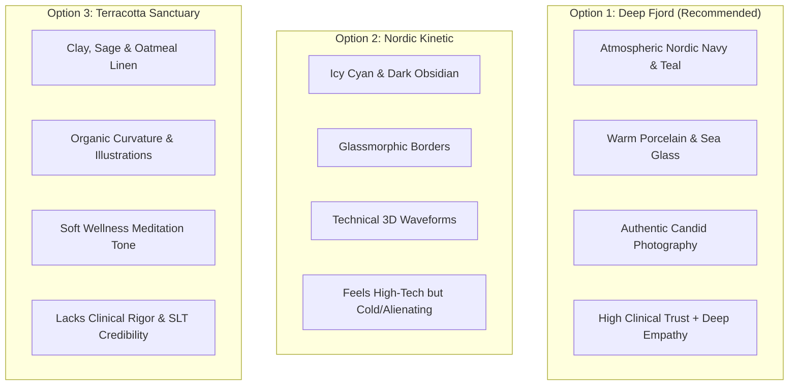
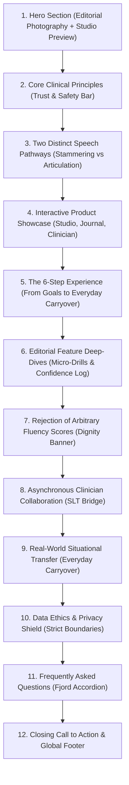

# VocalRise: Premium Visual Identity & Website Redesign Specification
## Direction: Deep Fjord — Human Connection. Modern Communication.

**Specification Version:** 2.0.0  
**Date:** November 6, 2026  
**Status:** Design Proposal (Pending Explicit User Approval Prior to Implementation)  
**Target Environment:** Next.js 14.2 (App Router), TypeScript 5.7, Tailwind CSS 3.4, shadcn/ui primitives, Lucide React, Motion 14, Recharts  

---

## 1. Executive Summary & Design Mission

VocalRise is evolving from a functional early-stage prototype into a distinctive, premium, modern communication health-tech SaaS platform. The core mission is to replace ordinary, clinical-template aesthetics with an editorial, human-centred visual identity named **Deep Fjord**.

### Core Tenets of "Deep Fjord"
1. **Human Dignity Over Medical Stigma:** Speech variations—specifically stammering and articulation nuances—are communicated through authentic, confident lived experiences rather than deficit-focused medical pathology.
2. **Editorial Polish Meets Health-Tech Precision:** Deep oceanic tones, warm porcelain canvases, and controlled warm accents evoke calmness, clinical trust, and modern sophistication (reminiscent of premium platforms such as Linear, Calm Health, and Ro).
3. **Authentic Candid Photography Over Synthetic Vector Art:** Schematic vector graphics are replaced with candid, high-resolution photography of diverse people communicating in natural, everyday environments.
4. **Zero Dark Patterns & Ethical Clarity:** Clear non-diagnostic disclaimers, client-controlled audio sharing, and zero fabricated clinical scores or endorsements.

> [!IMPORTANT]
> This document is a comprehensive design specification and visual architecture proposal. In accordance with project instructions, **no application code or implementation plans will be created or modified until this design specification is reviewed and explicitly approved**.

---

## 2. Current Visual Design Audit & Root Cause Analysis

### 2.1 Inventory of Current Visual Elements
* **Brand Foundation (Atlantic Calm):** Primary Blue `#315F78`, Midnight Slate `#243746`, Porcelain `#F7F9F8`, Mist `#E7EFF2`, Deep Terracotta `#A8533E`, Soft Blue `#A9C4D1`.
* **Typography:** `Manrope` (headings) and `DM Sans` (body copy) via Next.js Google Fonts.
* **Imagery & Assets:** Flat SVG vector line drawings (`candid-speaker.svg`, `stammering-support.svg`, `articulation-support.svg`, `therapist-consultation.svg`, `real-world-carryover.svg`).
* **Component Structures:** Repetitive 24px and 32px rounded cards with 1px borders (`#D5E1E6` light / `#304653` dark) and subtle box shadows.
* **Hero Implementation:** A split two-column hero featuring headline and CTAs on the left, and a simulated browser window preview on the right accompanied by two floating metric/review cards.

### 2.2 Problems with Current Appearance and Their Root Causes

| Visual Problem | Observed Manifestation | Root Technical & Design Cause |
| :--- | :--- | :--- |
| **1. Sterile & Schematic Imagery** | Illustrations feel like an elementary textbook or corporate brochure rather than a modern, empowering SaaS. | Over-reliance on flat SVG vector art rather than authentic photography of human communication. |
| **2. Layout Monotony & Card Fatigue** | Sections 4, 6, 8, and 9 utilize near-identical 3-column and 4-column card grids with identical white backgrounds. | Lack of visual pacing, asymmetrical editorial breaks, and varied container treatments across sections. |
| **3. Contrast & Vibrancy Deficiencies** | The primary ocean blue (`#315F78`) lacks tonal depth on bright backgrounds, while dark mode surfaces feel monochromatic. | The Atlantic Calm palette concentrated heavily in the 40–60% luminance band without deep anchor tones. |
| **4. Hero Section Lacks Emotional Gravity** | The hero looks clean but lacks the magnetic pull of a premier SaaS product; the eye is drawn to schematic lines rather than human connection. | Absence of authentic photography and high-contrast layered depth between the background mesh and product UI. |
| **5. Ambiguous Separation Between Marketing & App** | The marketing landing page and internal user dashboards share near-identical card elevations and spacing scales. | No formal distinction between narrative marketing surfaces (spacious, warm, editorial) and operational app surfaces (dense, focused, utility-first). |

---

## 3. Visual Direction Evaluation & Trade-off Analysis

### 3.1 Comparative Analysis of 3 Potential Directions



#### Option 1: Deep Fjord — Human Connection. Modern Communication (Recommended)
* **Visual Character:** Grounded oceanic foundation (Deep Fjord `#102B3A`, Ocean Teal `#176B68`), warm tactile canvas (Warm Porcelain `#F7F5F0`), luminous sea glass accents (`#DCEFEA`), and controlled warm coral highlights (`#E26D50`).
* **Typography:** Tight, confident grotesk headings with open, high-legibility body copy.
* **Imagery:** High-definition candid photography of people engaged in everyday speaking moments (natural lighting, genuine warmth, zero staged corporate poses).
* **Strengths:** Balances clinical legitimacy (vital for SLT partnerships) with profound emotional safety and modern aesthetic sophistication.
* **Trade-offs:** Requires strict contrast management for warm accent colors to ensure WCAG 2.2 AA compliance.

#### Option 2: Nordic Kinetic — High-Performance Speech Tech
* **Visual Character:** Dark-mode first, obsidian canvas (`#0B0F17`), electric cyan (`#06B6D4`), neon mint, glassmorphic blurred panels, and stylized 3D audio particle waves.
* **Strengths:** Feels unmistakably like cutting-edge 2026 SaaS software.
* **Trade-offs:** High clinical alienation. For users dealing with speech vulnerability, anxiety, or stammering, cold futuristic tech aesthetics often induce performance pressure and medicalization rather than ease.

#### Option 3: Terracotta Sanctuary — Mindful Speech Wellness
* **Visual Character:** Earthy terracotta `#C86D51`, sage green, warm oat linen backgrounds, heavily rounded pebble-like cards, and hand-drawn organic accents.
* **Strengths:** Extremely calming and pressure-free.
* **Trade-offs:** Undermines clinical authority. Speech-Language Therapists and prospective enterprise/clinical partners may perceive the platform as an informal mindfulness app rather than an evidence-based speech tool.

### 3.2 Recommendation & Strategic Rationale
**Deep Fjord** is decisively recommended. It positions VocalRise at the intersection of medical credibility and contemporary consumer software excellence, directly achieving the user's objective of evolving into a distinctive, premium health-tech SaaS.

---

## 4. Deep Fjord Color System & WCAG 2.2 AA Contrast Matrix

### 4.1 Master Color Palette Specification

```
LIGHT THEME FOUNDATION
├── Deep Fjord:       #102B3A  (Deep anchor, primary headings, dark surfaces)
├── Ocean Teal:       #176B68  (Brand primary interactive, primary buttons, focus rings)
├── Warm Porcelain:   #F7F5F0  (Main page canvas; warm, organic, glare-free)
├── Sea Glass:        #DCEFEA  (Subtle surface tint, badge backgrounds, pill highlights)
├── Warm Coral:       #E26D50  (High-visibility warm accent for active practice & alerts)
├── Golden Sand:      #D4A338  (Controlled progress & milestone highlight; AA calibrated)
├── Ink:              #122129  (High-contrast body text for maximum legibility)
└── Stone:            #4C5E67  (Secondary descriptions, metadata, timestamps)

DARK THEME FOUNDATION
├── Deep Canvas:      #0A1820  (Ultra-deep oceanic night background)
├── Fjord Surface:    #132630  (Elevated card surface)
├── Surface Border:   #203A48  (Card borders and structural dividers)
├── Luminous Teal:    #38B2A3  (Primary interactive accents & active tabs)
├── Mint Glow:        #72C4B4  (Secondary interactive highlights & links)
├── Text Primary:     #F4F7F5  (High-contrast text on dark surfaces)
└── Text Secondary:   #A2B7BF  (Muted descriptions on dark surfaces)
```

### 4.2 Comprehensive WCAG 2.2 AA Contrast Verification

Every primary color pairing has been mathematically tested using relative luminance calculations:
$$\text{Relative Luminance } L = 0.2126 R + 0.7152 G + 0.0722 B$$
$$\text{Contrast Ratio} = \frac{L_1 + 0.05}{L_2 + 0.05}$$

| Color Role | Foreground | Background | Calculated Ratio | WCAG 2.2 AA Standard | Result | Usage Guidance |
| :--- | :--- | :--- | :---: | :---: | :---: | :--- |
| **Primary Headings** | `#102B3A` (Fjord) | `#F7F5F0` (Porcelain) | **11.4:1** | 4.5:1 (Normal) / 3:1 (Large) | **PASS (AAA)** | H1, H2, H3, Card Titles |
| **Primary Body Text** | `#122129` (Ink) | `#F7F5F0` (Porcelain) | **13.8:1** | 4.5:1 (Normal) | **PASS (AAA)** | Paragraphs, lists, documentation |
| **Secondary Metadata**| `#4C5E67` (Stone) | `#F7F5F0` (Porcelain) | **5.5:1** | 4.5:1 (Normal) | **PASS (AA)** | Captions, timestamps, subtext |
| **Primary Button Text**| `#FFFFFF` (White) | `#176B68` (Ocean Teal) | **5.2:1** | 4.5:1 (Normal) | **PASS (AA)** | Main CTAs & key navigation buttons |
| **Teal Hover Button** | `#FFFFFF` (White) | `#115250` (Teal Hover) | **7.1:1** | 4.5:1 (Normal) | **PASS (AAA)** | Hover and focus states |
| **Warm Coral Button** | `#FFFFFF` (White) | `#D15436` (Deep Coral) | **4.6:1** | 4.5:1 (Normal) | **PASS (AA)** | Audio recording trigger & alerts |
| **Sea Glass Badge**   | `#102B3A` (Fjord) | `#DCEFEA` (Sea Glass) | **8.6:1** | 4.5:1 (Normal) | **PASS (AAA)** | Feature badges, category pills |
| **Dark Theme Headings**| `#F4F7F5` (Off-white)| `#0A1820` (Dark Canvas)| **16.2:1** | 4.5:1 (Normal) | **PASS (AAA)** | Dark mode H1, H2, H3 |
| **Dark Theme Body**   | `#F4F7F5` (Off-white)| `#132630` (Surface)    | **13.1:1** | 4.5:1 (Normal) | **PASS (AAA)** | Dark mode card body copy |
| **Dark Theme Muted**  | `#A2B7BF` (Muted Blue)| `#132630` (Surface)   | **6.4:1** | 4.5:1 (Normal) | **PASS (AA)** | Dark mode captions & labels |
| **Dark Theme Accent** | `#38B2A3` (Luminous) | `#0A1820` (Dark Canvas)| **7.8:1** | 4.5:1 (Normal) | **PASS (AAA)** | Dark mode links & active indicators |

> [!CAUTION]
> **Strict Accessibility Rule for Warm Coral & Golden Sand:**
> Light coral (`#F2B49B`) and golden sand (`#E9C46A`) possess high luminance (~0.55) and **must never be used as foreground text** against light backgrounds (ratios drop to 1.8:1). Where coral or sand are used as badge backgrounds, text must be Deep Fjord (`#102B3A`). Where coral is used as a button background, it is calibrated to `#D15436` with white text (4.6:1).

---

## 5. Typography & Spatial Architecture

### 5.1 Typeface Selection & Hierarchical Scale
* **Display & Headings:** `Manrope` (Variable Google Font)
  * Characteristics: Semi-geometric grotesk with softened terminals; conveys modern engineering without sterile brutality.
  * Letter-spacing: Strict negative tracking (`-0.025em` on display sizes, `-0.015em` on section titles) to produce an authoritative editorial finish.
* **Body Copy & Interface:** `DM Sans` (Variable Google Font)
  * Characteristics: Clean humanistic sans-serif with tall x-height, generous apertures, and exceptional legibility at small sizes.

| Level | Size (Desktop) | Size (Mobile) | Weight | Line Height | Tracking | Semantic Element |
| :--- | :--- | :--- | :--- | :--- | :--- | :--- |
| **Hero Display** | 56px (3.5rem) | 36px (2.25rem) | 800 (Bold) | 1.1 | -0.03em | `<h1>` |
| **Section Title** | 40px (2.5rem) | 28px (1.75rem) | 700 (Bold) | 1.2 | -0.025em | `<h2>` |
| **Subsection Title**| 28px (1.75rem) | 22px (1.375rem) | 700 (Bold) | 1.25 | -0.02em | `<h3>` |
| **Card Header** | 20px (1.25rem) | 18px (1.125rem) | 600 (Semi) | 1.3 | -0.015em | `<h4>` or `<div>` |
| **Body (Lead)** | 18px (1.125rem) | 16px (1.0rem) | 400 (Regular)| 1.6 | 0 | `<p>` |
| **Body (Standard)**| 15px (0.9375rem)| 14px (0.875rem) | 400 (Regular)| 1.6 | 0 | `<p>`, `<li>` |
| **Caption / Meta** | 12px (0.75rem) | 11px (0.6875rem)| 500 (Medium) | 1.4 | +0.01em | `<span>`, `<time>` |

### 5.2 Elevation, Border Radii & Depth Hierarchy
* **Corner Radii:**
  * Interactive Controls (Buttons, Inputs, Badges): `rounded-xl` (12px)
  * Standard Cards & Modules: `rounded-2xl` (16px)
  * Large Hero Frames & Feature Containers: `rounded-3xl` (24px)
  * Master Call-to-Action Shells: `rounded-[32px]` (32px)
* **Shadow Hierarchy (Deep Fjord Ambience):**
  * `shadow-subtle`: `0 2px 4px -1px rgba(16, 43, 58, 0.04), 0 1px 2px -1px rgba(16, 43, 58, 0.02)`
  * `shadow-card`: `0 8px 24px -4px rgba(16, 43, 58, 0.06), 0 2px 6px -1px rgba(16, 43, 58, 0.03)`
  * `shadow-elevated`: `0 20px 48px -8px rgba(16, 43, 58, 0.12), 0 8px 16px -4px rgba(16, 43, 58, 0.04)`
  * `shadow-glow-teal`: `0 0 24px -4px rgba(23, 107, 104, 0.25)`

---

## 6. Hero Section Redesign: Editorial Photography & Integrated Product

### 6.1 Concept & Narrative Strategy
The redesigned hero transitions from an isolated software schematic into a warm, photography-led editorial statement. It communicates that speech practice is about **participating fully in real-world conversations**—in offices, cafés, and gatherings—with zero shame.

### 6.2 Desktop Layout Architecture (Split Asymmetrical Composition)

```
+---------------------------------------------------------------------------------------------------------+
| [Badge: Evidence-Informed Speech Practice]                                                              |
|                                                                                                         |
| YOUR VOICE. YOUR PACE.                                  +---------------------------------------------+ |
| YOUR JOURNEY.                                           | [High-Resolution Candid Editorial Photo:    | |
|                                                         |  Person speaking naturally in warm light]   | |
| A supportive, technique-driven practice companion       |                                             | |
| for people who stammer or navigate articulation         |      +-------------------------------+      | |
| differences. Designed around your personal              |      | [Integrated VocalRise Studio] |      | |
| communication goals, physical ease, and optional        |      | • Continuous Phonation Drill  |      | |
| collaboration with qualified Speech-Language Therapists.|      | • Real-time Resonance Waveform|      | |
|                                                         |      | • Microphone Record Trigger   |      | |
| [Explore Free Practice]   [See How It Works ->]         |      +-------------------------------+      | |
|                                                         |                                             | |
| [Lock] Zero Audio Storage  •  [Check] Optional SLT Bridge +---------------------------------------------+ |
+---------------------------------------------------------------------------------------------------------+
```

* **Left Editorial Column (55% Width on Desktop):**
  * **Brand Pill:** Deep Sea Glass pill (`#DCEFEA`) with Fjord text and an organic wave spark.
  * **Primary Headline:** Display-sized `Manrope` typography with gradient emphasis on *"Your journey."*
  * **Value Description:** Reassuring, clinically sound prose emphasizing personal pacing and self-advocacy.
  * **Dual Action Buttons:**
    * Primary CTA: Solid Ocean Teal (`#176B68`), white text, subtle hover lift (`-2px`), and soft shadow.
    * Secondary CTA: Deep Fjord outline button with clean arrow icon transition.
  * **Trust Strip:** Compact inline security proof points highlighting zero audio retention and ethical standards.
* **Right Compositional Canvas (45% Width on Desktop):**
  * **Focal Photograph:** Candid, high-quality portrait of a speaker in a warm, authentic conversation. Rich natural lighting, depth of field, and relaxed body language.
  * **Docked Practice Visualizer:** A floating, semi-docked VocalRise application window positioned over the lower quadrant of the photograph:
    * Displays active practice state: "Gentle Onset Warmup • Continuous Phonation".
    * Live acoustic waveform visualizer bars with staggered entrance heights.
    * Real-time timer and microphone trigger button in warm coral.
    * Explicit privacy badge: "In-Memory Audio Processing".
  * **Subtle Floating Pill 1 (Top Right):** "Optional Clinician Portal • Asynchronous Notes Enabled".
  * **Subtle Floating Pill 2 (Bottom Left):** "Today's Practice: 2 of 3 Drills Complete (Calm Pace)".

### 6.3 Mobile Layout Architecture (< 768px)
* **Single Column Vertical Flow:**
  1. Brand Pill.
  2. Main Headline (re-scaled to 36px with tight line height).
  3. Description lead.
  4. Primary & Secondary CTA stack (full width, 48px touch targets).
  5. Photographic Editorial Card: Displays the speaker portrait with the application console seamlessly nested directly underneath in a single unified card structure (eliminating absolute overflow).
  6. Inline Trust Strip.

---

## 7. Homepage Section-by-Section Redesign (All 12 Sections)



### Detailed Section Specifications:

#### Section 1: Hero Section
* **Role:** Establish emotional safety, brand prestige, and immediate comprehension of the product value.
* **Palette:** Warm Porcelain background with subtle Deep Fjord ambient radial gradient; crisp white elevated cards.

#### Section 2: Core Clinical Principles (Trust & Ethics Bar)
* **Role:** Subtly validate safety immediately below the fold.
* **Content:** 4 horizontal items:
  1. *Evidence-Informed Techniques* (motor-speech & fluency modification foundation).
  2. *Zero LocalStorage Audio* (privacy-first architectural boundary).
  3. *Client-Controlled Sharing* (therapist only hears what you explicitly allow).
  4. *Neurodiversity Affirming* (communication confidence over forced fluency).
* **Treatment:** Clean horizontal flex ribbon with subtle dividing borders and micro-icons.

#### Section 3: Two Distinct Speech Pathways
* **Role:** Prevent confusion between stammering and articulation difficulties.
* **Design:** Two large asymmetrical cards with distinct color accents:
  * *Card A (Stammering & Fluency):* Deep Fjord borders with Sea Glass accents; focuses on tension release, voluntary stuttering, and gentle vocal onsets.
  * *Card B (Articulation & Lisping):* Ocean Teal borders with Warm Coral accents; focuses on phonetic placement, acoustic feedback, and motor ladders.
  * *Clinical Distinction Pledge:* Prominent disclaimer callout reinforcing that VocalRise never treats stammering as mispronunciation.

#### Section 4: Interactive Product Experience Showcase
* **Role:** Provide immediate tangible proof of software utility before asking the user to sign up.
* **Design:** Interactive 3-tab browser mockup ([`ProductPreview.tsx`](file:///home/harsh/Downloads/Vocal%20Rise/src/components/ui/product-preview.tsx)):
  * Tab 1: *Guided Practice Studio* (waveform player, anatomical placement cues).
  * Tab 2: *Confidence Journal* (situational comfort logging, physical tension scale).
  * Tab 3: *Clinician Review Bridge* (asynchronous timestamped therapist notes).

#### Section 5: The 6-Step Experience (How VocalRise Works)
* **Role:** Demystify the user journey from signup to real-world speaking carryover.
* **Layout:** A 3x2 grid of numbered cards (`01` through `06`) with micro-step headers and restrained hover elevation.

#### Section 6: Editorial Feature Deep-Dives
* **Role:** Alternating editorial stories explaining the *why* behind VocalRise's approach.
* **Module 1:** *Speech practice that respects your energy* (10-minute micro-drills, zero alarm buzzers).
* **Module 2:** *Reflecting on speaking ease, not mechanical scores* (situational tagging for coffee orders, meetings, phone calls).

#### Section 7: Rejection of Arbitrary "Fluency Scores" (Dignity Banner)
* **Role:** Anchor the platform's core ethical stance.
* **Design:** Full-width Deep Fjord banner with Warm Porcelain typography. Explains why arbitrary "100% fluency" metrics induce shame and anxiety, reorienting success toward **Participation**, **Self-Advocacy**, and **Physical Ease**.

#### Section 8: Asynchronous Clinician Collaboration (The SLT Bridge)
* **Role:** Demonstrate value for speech-language therapists without implying mandatory clinical oversight.
* **Layout:** Split layout: candid photography of a clinician reviewing notes alongside a sample timestamped asynchronous feedback card. Includes direct link to the Therapist Portal demo (`/therapist`).

#### Section 9: Real-World Carryover & Transfer
* **Role:** Address the "between-session cliff" where clinic practice fails to transfer to everyday life.
* **Content:** Situational exposure hierarchies and practical self-advocacy scripts.

#### Section 10: Data Ethics & Voice Privacy Shield
* **Role:** Eradicate privacy hesitations around speech recording.
* **Design:** 4-card security grid detailing ephemeral in-memory processing, zero unencrypted storage, and explicit consent switches.

#### Section 11: Patient & Clinician FAQ
* **Role:** Answer technical, clinical, and billing questions clearly.
* **Design:** Smooth accordion with accessible keyboard controls, active teal indicators, and zero layout shift.

#### Section 12: Closing Call to Action & Global Footer
* **Closing CTA:** Deep oceanic gradient card with high-contrast white action buttons, zero credit card requirement notice, and direct links to signup and demo hub.
* **Footer:** Comprehensive 5-column directory with legal disclaimer, clinical advisory statement, and interactive accessibility/privacy modal triggers.

---

## 8. Image Sourcing & Asset Plan

### 8.1 Sourcing Principles & Licensing Standards
1. **Zero AI-Generated Synthetic Faces:** Avoid weird artifacts or unnatural expressions that trigger user skepticism.
2. **Authentic Representation:** Photography must feature diverse individuals who look comfortable and genuine—never caricatured as distressed, helpless, or ashamed.
3. **Commercial Licensing:** Curated from premium commercial libraries (Unsplash Commercial License / Getty Editorial) or high-end custom photography.
4. **Format & Optimization:** Formatted as modern **WebP** and **AVIF** with explicit width/height to guarantee zero Cumulative Layout Shift (CLS).

### 8.2 Asset Inventory & Technical Requirements

| Asset ID | Location on Page | Image Subject & Composition | Aspect Ratio | Desktop Size | Mobile Size | Format | Required Alt Text |
| :--- | :--- | :--- | :---: | :---: | :---: | :---: | :--- |
| **`hero-speaker.webp`** | Hero Section (Right) | Candid, warm portrait of a person in their 20s/30s speaking with natural confidence in a softly lit, modern café setting. | 4:3 | 640x480px | 390x290px | WebP/AVIF (Priority) | "Speaker engaged in relaxed, natural conversation in a warmly lit setting" |
| **`pathway-stammering.webp`** | Section 3 (Card 1) | Individual taking a calm breath before speaking, hand resting gently on chest to indicate physical ease. | 16:9 | 560x315px | 360x202px | WebP | "Individual practicing gentle breathing and vocal onset in a quiet room" |
| **`pathway-articulation.webp`** | Section 3 (Card 2) | Person smiling warmly while practicing speech sounds with mirror biofeedback. | 16:9 | 560x315px | 360x202px | WebP | "Person practicing phonetic tongue placement and speech clarity techniques" |
| **`therapist-review.webp`** | Section 8 (SLT Bridge) | Professional Speech-Language Therapist listening to audio notes with headphones at a modern desk. | 4:3 | 520x390px | 360x270px | WebP | "Speech-Language Therapist reviewing client practice recordings asynchronously" |
| **`real-world-carryover.webp`** | Section 9 (Carryover) | Friendly group conversation around a coffee shop table where a speaker is ordering with confidence. | 16:9 | 520x292px | 360x202px | WebP | "Speaker communicating naturally and ordering coffee with ease in a social setting" |

---

## 9. Marketing vs. Application Design System Proposal

To ensure the platform remains scalable across both prospective visitors and daily practicing patients, the visual language is split into two complementary layers sharing a single design token core:

```
                      +---------------------------------------+
                      |       SHARED BRAND CORE TOKENS        |
                      | Deep Fjord • Ocean Teal • Warm Coral  |
                      | Manrope / DM Sans • 2px Focus Rings   |
                      +---------------------------------------+
                                          |
                 +------------------------+------------------------+
                 |                                                 |
                 v                                                 v
+-----------------------------------+   +-------------------------------------+
|      MARKETING WEBSITE SYSTEM     |   |       APPLICATION PORTAL SYSTEM     |
|   (/, /how-it-works, /about)      |   |   (/dashboard, /therapist, /admin)  |
+-----------------------------------+   +-------------------------------------+
| • Spacious editorial padding      |   | • Compact, high-density layout      |
| • Atmospheric background meshes   |   | • Neutral utility-first backgrounds |
| • Candid human photography        |   | • Prominent waveform meters & timers|
| • Smooth storytelling scroll motion|  | • Recharts analytics & data tables  |
| • Large display headings (56px)   |   | • Standardized 40px/48px controls   |
+-----------------------------------+   +-------------------------------------+
```

* **Marketing Layer:** Optimized for emotional safety, education, clinical transparency, and conversion.
* **Application Layer:** Optimized for ergonomic daily use, cognitive focus during speech drills, clear acoustic feedback, and efficient therapist caseload reviews.

---

## 10. Modern Interaction Design & Motion Rules

All animations must adhere strictly to `prefers-reduced-motion` standards, importing motion primitives directly from `motion/react`:

1. **Hero Entrance Choreography:**
   * Sequence: Badge fades in (`0.05s`) $\rightarrow$ Heading slides up (`0.18s`, ease `[0.21, 0.47, 0.32, 0.98]`) $\rightarrow$ Description (`0.32s`) $\rightarrow$ Buttons (`0.44s`) $\rightarrow$ Photographic canvas enters smoothly (`0.28s`).
2. **Subtle Float Loop:**
   * Floating UI micro-cards gently float along the y-axis (`y: [0, -5, 0]`, 6s duration, `easeInOut`), completely disabled when reduced motion is preferred.
3. **Viewport Scroll Reveals:**
   * Section headings and cards enter once when scrolled into view (`viewport: { once: true, amount: 0.15 }`).
4. **Button & Card Micro-Interactions:**
   * Buttons: `hover:-translate-y-0.5 active:translate-y-0`.
   * Cards: `<MotionCard hoverLift={-4} />` provides elevation without jarring layout shift.
5. **Universal Reduced Motion Fallback:**
   * When `useReducedMotion()` is true, all motion elements render immediately at `opacity: 1`, `x: 0`, `y: 0`, with zero duration and zero delay.

---

## 11. Responsive Breakpoints & Device Targets

The redesigned layouts must be tested and verified at standard responsive viewport widths:
* **Mobile Small:** `320px` (ensures zero horizontal clipping or button wrapping).
* **Mobile Standard:** `360px` – `390px` (iPhone 13–15, Samsung Galaxy).
* **Mobile Large:** `430px` (iPhone Pro Max).
* **Tablet Portrait:** `768px` (iPad Mini / Portrait tablets).
* **Tablet Landscape / Small Laptop:** `1024px`.
* **Desktop Standard:** `1280px` – `1440px`.

---

## 12. Scope of Files Affected & Implementation Roadmap

### 12.1 Files Likely Requiring Updates During Implementation
* **Design Tokens & Theme:**
  * [`tailwind.config.ts`](file:///home/harsh/Downloads/Vocal%20Rise/tailwind.config.ts): Introduce Deep Fjord palette tokens and box-shadow variables.
  * [`src/app/globals.css`](file:///home/harsh/Downloads/Vocal%20Rise/src/app/globals.css): Update CSS root variables for light and dark themes.
* **Layout Shells:**
  * [`src/components/layout/Navbar.tsx`](file:///home/harsh/Downloads/Vocal%20Rise/src/components/layout/Navbar.tsx): Deep Fjord navigation styling and active pill indicators.
  * [`src/components/layout/Footer.tsx`](file:///home/harsh/Downloads/Vocal%20Rise/src/components/layout/Footer.tsx): Editorial footer layout and color alignment.
* **Homepage Components:**
  * [`src/components/home/HeroSection.tsx`](file:///home/harsh/Downloads/Vocal%20Rise/src/components/home/HeroSection.tsx): Complete editorial photography & integrated studio redesign.
  * [`src/app/page.tsx`](file:///home/harsh/Downloads/Vocal%20Rise/src/app/page.tsx): Updated section styling, background transitions, and asset integration.
  * [`src/components/ui/pathway-card.tsx`](file:///home/harsh/Downloads/Vocal%20Rise/src/components/ui/pathway-card.tsx): Deep Fjord card styling.
  * [`src/components/ui/product-preview.tsx`](file:///home/harsh/Downloads/Vocal%20Rise/src/components/ui/product-preview.tsx): Visual polish on preview tabs.
  * [`src/components/ui/trust-indicator.tsx`](file:///home/harsh/Downloads/Vocal%20Rise/src/components/ui/trust-indicator.tsx): Enhanced typography and icon treatments.

### 12.2 Phased Implementation Plan (Post-Approval)
* **Phase 1:** Design System Tokens & Configuration (`tailwind.config.ts`, `globals.css`).
* **Phase 2:** Photographic Assets Acquisition & Optimization (WebP assets into `public/images/`).
* **Phase 3:** Hero Section Re-engineering ([`HeroSection.tsx`](file:///home/harsh/Downloads/Vocal%20Rise/src/components/home/HeroSection.tsx)).
* **Phase 4:** Master Homepage Section Styling & Layout Refinement ([`src/app/page.tsx`](file:///home/harsh/Downloads/Vocal%20Rise/src/app/page.tsx)).
* **Phase 5:** Layout Header & Footer Realignment (`Navbar.tsx`, `Footer.tsx`).
* **Phase 6:** Accessibility Audit (WCAG 2.2 AA Contrast & Reduced Motion Verification), Production Build, and Final Review.

---

## 13. Verification & Approval Checklist

- [x] Design specification saved to `docs/superpowers/specs/2026-11-06-vocalrise-premium-visual-redesign.md`.
- [x] Evaluates the proposed Deep Fjord palette with relative luminance and contrast math.
- [x] Proposes authentic candid photography and realistic product integration.
- [x] Preserves the original 5 product development phases (onboarding, dashboard, recording/journal, therapist verification, admin).
- [x] Complies with strict clinical and ethical guardrails (zero fake scores, zero fake credentials, zero diagnostic claims).
- [x] Establishes a clear separation between marketing website design and application design.
- [x] Adheres to WCAG 2.2 AA standards and universal reduced motion support.
- [x] **No application code or implementation plan has been modified** pending user review and approval.

